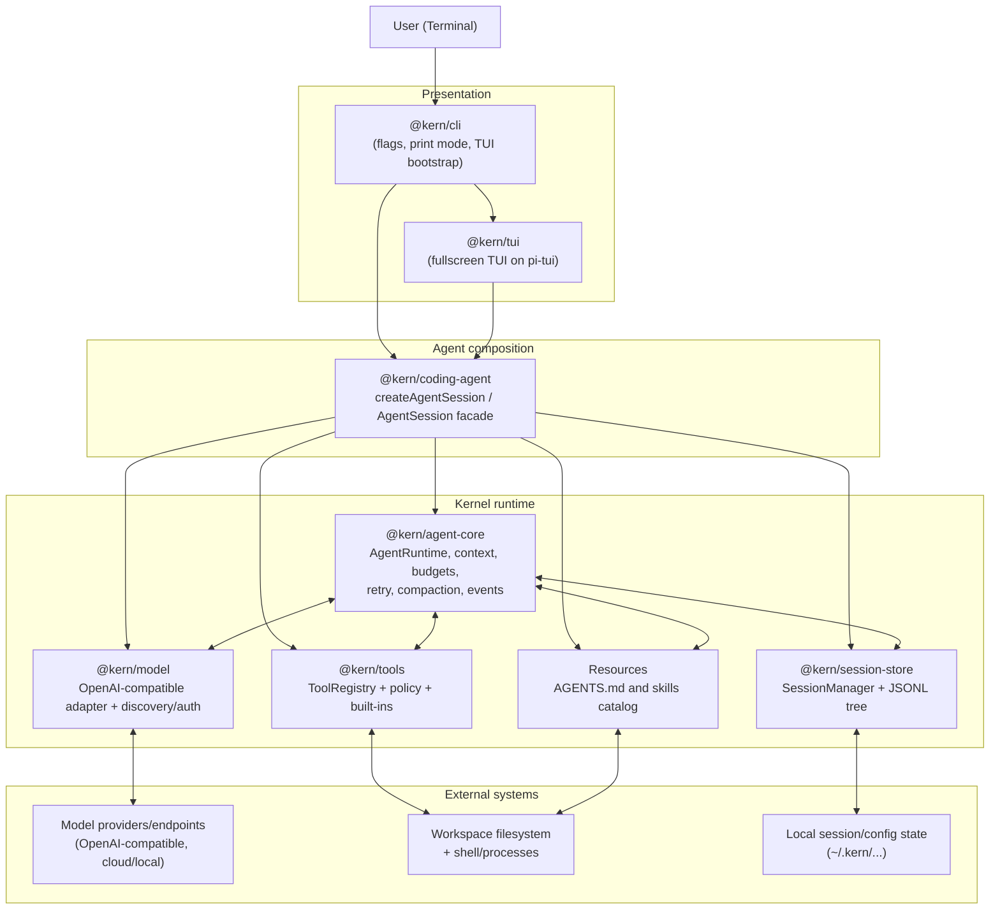
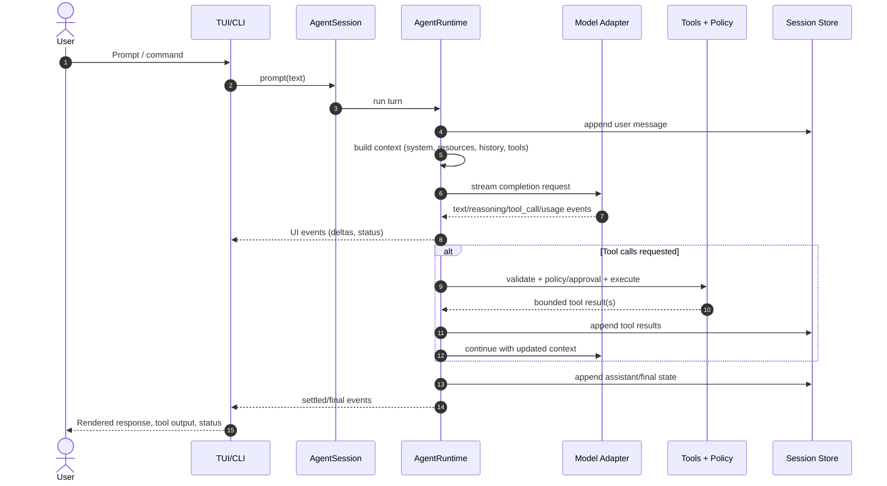

# Kern

Kern is a minimal, from-first-principles terminal coding agent kernel. It runs in an interactive TUI by default, can execute tools with explicit policy/approval checks, persists sessions locally, and works with OpenAI-compatible model endpoints (cloud or local).

> **Status:** release `1.0.0` (Node.js / npm workspaces monorepo).

## Table of contents

- [Introduction](#introduction)
- [Key features](#key-features)
- [Architecture](#architecture)
- [Repository structure](#repository-structure)
- [Getting started](#getting-started)
  - [Prerequisites](#prerequisites)
  - [Clone the repository](#clone-the-repository)
  - [Install dependencies](#install-dependencies)
  - [Configure a model/provider](#configure-a-modelprovider)
  - [Run Kern](#run-kern)
- [Usage](#usage)
  - [Interactive TUI (default)](#interactive-tui-default)
  - [Session management (`/session`)](#session-management-session)
  - [Prompt shortcuts and approvals](#prompt-shortcuts-and-approvals)
  - [Print mode (non-interactive)](#print-mode-non-interactive)
  - [Common commands and flags](#common-commands-and-flags)
- [Development](#development)
- [Testing and type checking](#testing-and-type-checking)
- [Documentation](#documentation)
- [Contributing](#contributing)
- [License](#license)

## Introduction

Kern provides a small, inspectable coding-agent runtime with:

- a **terminal-first UX** (fullscreen TUI with streaming output, collapsible thinking/tool details, status/activity, session panel)
- a **kernel/runtime core** for turns, context assembly, budgets, retry/compaction, and event-driven execution
- **tool execution with policy and approvals** (`read`, `write`, `edit`, `bash`, `grep`, `find`, `git-*`, etc.) instead of implicit authority
- **local session persistence** (JSONL session history, resume/switch/export)
- **model-provider flexibility** through an OpenAI-compatible adapter and model discovery/config flow

The design goal is to keep behavior understandable and recoverable: durable state, explicit boundaries, bounded tool output, and fail-closed safety where appropriate.

## Key features

- **Interactive TUI by default** on TTY terminals
  - Streaming assistant responses
  - Collapsible thinking and tool cards
  - Prompt editor with autocomplete
  - Session sidebar (model/session/usage/budgets, best-effort live stats)
  - Keyboard-first workflow with mouse support where the terminal/framework allows
- **Session management via `/session`** (single command)
  - List/switch saved sessions (loaded from saved session file paths)
  - Rename, create new session, show session info (ID/path/model), export transcript
- **Safety and control**
  - Approval prompts for sensitive actions (fail-closed)
  - Bounded output and runtime budgets
  - Best-effort `/undo` and `/redo` for file changes in git workspaces
- **Model support**
  - OpenAI-compatible endpoints (cloud/local)
  - Model discovery/config/auth helpers
  - In-TUI model/provider flows (`/model`, `/connect`, `/keys`)
- **Minimal monorepo architecture**
  - Separate packages for protocol, session store, tools, agent core, model layer, coding-agent facade, CLI, and TUI

## Architecture

### High-level system architecture



### Turn/execution flow (simplified)



### Package boundaries (current monorepo)

- **`@kern/protocol`**: shared contracts (messages, session entries, events, errors, schemas, utilities)
- **`@kern/session-store`**: append-only JSONL session persistence and session tree/management primitives
- **`@kern/tools`**: tool definitions/registry, validation, path safety, policy/approvals, built-in tools (`read`, `write`, `edit`, `bash`)
- **`@kern/agent-core`**: agent loop/runtime, context building, compaction, budgets, retry, event bus integration
- **`@kern/model`**: OpenAI-compatible model adapter, provider/model discovery, auth/config helpers
- **`@kern/coding-agent`**: session composition/facade (`createAgentSession`, runtime/session operations exposed to UIs)
- **`@kern/cli`**: CLI entrypoint, argument parsing, print mode, TUI bootstrap
- **`@kern/tui`**: interactive terminal UI (layout, rendering, commands, dialogs, approvals, session UX)

> Design principle: runtime/core logic stays UI-agnostic; presentations (CLI/TUI) observe events and act through the session API.

## Repository structure

```text
.
├── packages/
│   ├── agent-core/         # Agent runtime/loop, context, budgets, compaction, retry
│   ├── cli/                # CLI entrypoint and mode selection
│   ├── coding-agent/       # Session facade/composition
│   ├── model/              # Model adapter, discovery, auth/config helpers
│   ├── protocol/           # Shared types/contracts/schemas
│   ├── session-store/      # JSONL session persistence/tree
│   ├── tools/              # Tool registry, policy, built-in tools
│   └── tui/                # Interactive terminal UI
├── docs/                   # Additional docs/specs (project-specific)
├── .agents/                # Repo-local agent guides/skills/docs (development context)
├── USER_GUIDE.md           # TUI-focused user guide
├── README.md               # Project overview (this file)
├── package.json            # Root scripts, workspaces, and dev dependencies
└── server.ts               # Web workbench HTTP server (port 3000)
```

## Getting started

### Prerequisites

- **Node.js** `>= 20` (recommended: Node 22+ for best compatibility with current tooling/dependencies)
- **npm** `>= 10` (workspace scripts configured in `package.json`)
- Access to an **OpenAI-compatible model endpoint** (cloud or local) and credentials if required

### Clone the repository

```bash
git clone <repository-url>
cd <repository-folder>
```

If you are already working in this workspace/repo, skip cloning and run commands from the repository root.

### Install dependencies

```bash
npm install
```

### Configure a model/provider

Kern can work with configured providers/models and OpenAI-compatible endpoints. Common approaches:

1. **In the TUI (recommended for interactive setup):**

   - Use `/connect` to configure/authenticate a provider and test connectivity
   - Use `/model` to pick/switch models
2. **CLI flags / environment variables (useful for scripts or one-off runs):**

   - Provider/model: `--provider`, `--model` (or `KERN_PROVIDER`, `KERN_MODEL`)
   - Endpoint/key: `--base-url`, `--api-key` (or `KERN_BASE_URL`, `KERN_API_KEY`)
3. **Model/config files** (local user/project config under `.kern` locations, depending on setup)

> Secrets should be handled via secure local config/env mechanisms supported by your setup. Avoid committing credentials.

### Run Kern

Show version or help:

```bash
npm run kern -- --version
npm run kern -- --help
```

List available models (configured/discovered):

```bash
npm run kern -- --list-models
```

Start the interactive TUI (default on TTY):

```bash
npm run kern
```

Start the local web workbench (port 3000):

```bash
npm run dev
```

Start with a specific model/provider:

```bash
npm run kern -- --provider <provider> --model <model-id>
# or
npm run kern -- --model <provider>/<model-id>
```

Resume the most recent session:

```bash
npm run kern -- --resume
```

Resume a specific session by ID or session file path:

```bash
npm run kern -- --session <session-id>
# or
npm run kern -- --session /path/to/session.jsonl
```

## Usage

### Interactive TUI (default)

- Runs in a terminal UI for multi-turn coding workflows
- Streams responses and shows tool/thinking activity
- Supports approvals for sensitive tool actions
- Includes a docked prompt editor, status/activity indicators, and (on wide terminals) a session info panel

**In-TUI essentials**

- `Enter`: send prompt
- `Shift+Enter`: newline
- `Tab`: autocomplete
- `Esc` / `Ctrl+C`: stop/cancel (context-dependent)
- `/help`: show available commands

For a full TUI walkthrough, see **[USER_GUIDE.md](USER_GUIDE.md)**.

### Session management (`/session`)

`/session` is the single command for session management in the TUI.

- `/session` — open session management menu (switch, rename, new, info, export)
- `/session list` or `/session switch` — pick and load a saved session
- `/session rename [name]` — rename current session
- `/session new` — create/start a fresh session
- `/session info` (aliases: `/session id`, `/session path`, `/session current`) — show current session ID/name/model/path
- `/session export [file]` — export transcript

When you select a session, Kern loads it from its **saved session file path** and restores that session in the TUI.

### Prompt shortcuts and approvals

- **`@path/to/file`**: include file content in context (best-effort; size/binary/workspace checks apply)
- **`!command`**: run a shell command in shell mode (command output is used in the conversation flow)
- **Approvals**: sensitive actions may require approval
  - Fail-closed on cancel/deny/abort
  - Options typically include allow once / allow for session (tool-scoped) / deny
  - Review destructive operations carefully

### Print mode, JSON, and RPC (non-interactive)

Use `--print` for streamed, non-interactive output (scripting/CI/pipes), `--json` for NDJSON event streams, or `--rpc` for bidirectional stdin/stdout JSON-RPC control:

```bash
npm run kern -- --print "Summarize this repository"
npm run kern -- --json "List all TypeScript packages"
```

Notes:

- Assistant output streams to stdout; runtime/tool status goes to stderr
- Approval-required actions are denied in non-interactive/headless contexts (fail closed)

### Common commands and flags

> Run `npm run kern -- --help` for the authoritative CLI help.

| Command / Flag | Purpose |
| --- | --- |
| `npm run kern` | Start interactive TUI (default on TTY) |
| `npm run kern -- --print "..."` | Non-interactive streamed run |
| `npm run kern -- --json "..."` | NDJSON event stream output |
| `npm run kern -- --list-models` | List configured/discovered models |
| `npm run dev` | Start web workbench server on port 3000 |
| `--resume` | Resume most recent session |
| `--session <id \| path>` | Resume specific session ID or JSONL file |
| `--provider <name>` / `--model <id \| provider/id>` | Override provider or model |
| `--base-url <url>` / `--api-key <key>` | Override endpoint/auth |
| `--cwd <dir>` | Set workspace root |
| `--read-only` | Restrict to read-only tool behavior |
| `--max-turns`, `--max-wall-time-ms`, `--max-tool-calls-per-turn`, `--max-total-tool-calls` | Runtime budgets/limits |
| `--no-resources`, `--no-compaction` | Disable resource loading or auto-compaction |

## Development

### Root scripts

```bash
npm run typecheck          # TypeScript typecheck (no emit)
npm test                   # Run tests (Vitest)
npm run test:watch         # Watch mode
npm run dev                # Start web workbench server (port 3000)
npm run kern -- --help     # Run CLI entry (tsx)
```

### Local development notes

- This is an **npm workspaces monorepo** (`packages/*`)
- Packages export TypeScript source (`src/index.ts`) for fast in-repo development
- TUI behavior and command set evolve; prefer checking `packages/tui/src/tui.ts` and `USER_GUIDE.md` for current UX details

## Testing and type checking

Run all tests:

```bash
npm test
```

Run type checks:

```bash
npm run typecheck
```

Targeted package tests (examples):

```bash
npx vitest run packages/tui
npx vitest run packages/agent-core
npx vitest run packages/session-store packages/coding-agent packages/tui
```

## Documentation

- **[USER_GUIDE.md](USER_GUIDE.md)** — detailed TUI user guide
- **`packages/tui/README.md`** — TUI package notes/features
- **`.agents/`** — project/agent development notes, guides, and skills (useful for contributors working on this repo)

## Contributing

Contributions are welcome. Please keep changes focused, reviewable, and consistent with Kern’s architecture.

### Contribution workflow

1. **Fork/clone** the repository and create a branch for your change.
2. **Install dependencies** with `npm install`.
3. **Make focused changes** (prefer package-local fixes over broad refactors).
4. **Add/update tests** for behavior changes when applicable.
5. **Run checks** before submitting:
   - `npm test` (or targeted tests for affected packages)
   - `npm run typecheck`
6. **Update docs** (`README.md`, `USER_GUIDE.md`, package docs) if user-facing behavior or commands change.
7. **Open a pull request** with:
   - a clear summary of the problem and solution
   - affected packages/areas
   - test/verification results
   - any limitations or follow-up work

### Guidelines

- Preserve **package boundaries** and keep runtime/UI concerns separated
- Prefer **fail-closed** behavior for safety-sensitive paths (tools, approvals, auth/config)
- Keep tool output and UI behavior **bounded and user-visible**
- Avoid speculative features; document limitations honestly
- Do not commit secrets, API keys, or local credential files

## License

Licensed under the **Apache License 2.0**. See **[LICENSE](LICENSE)** for details.
