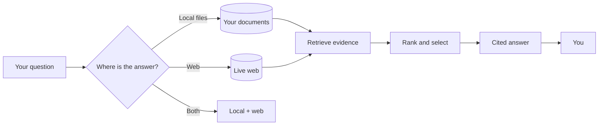
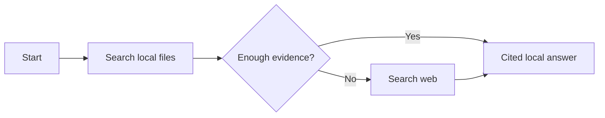

# 01 — What Is a Local Perplexity Computer?

> **Part I — First Principles — Chapter 1**
> Subproject: `docs/01-what-is-local-perplexity/index.md`

---

## 1. First-Principle Question

What is the essential unit of value in a research assistant, and why does a chatbot that answers from memory fail to satisfy it?

---

## 2. Mental Model

A chatbot is a constrained generator over its training weights. It produces plausible text, not grounded answers. A search engine returns ranked documents, leaving the user to synthesize. An answer engine sits between: it retrieves evidence first, then synthesizes a cited answer from that evidence. Local-first means the index, embeddings, and inference run on the user's device by default, so personal knowledge never leaves the machine unless explicitly permitted.

---

## 3. How Perplexity-Style Systems Work

Perplexity interprets a question, searches the web, retrieves sources, and returns a conversational answer with citations. The model is a constrained synthesizer over selected evidence rather than an unrestricted generator. The core loop: interpret → retrieve → rank → synthesize → cite.

Source: [Perplexity Help Center](https://www.perplexity.ai/help-center/en/articles/10352895-how-does-perplexity-work)

---

## 4. Local-First Adaptation

Replace the public web index with a personal local index of PDFs, notes, code, and saved pages. Keep web as an optional second source used only when local evidence is insufficient. All indexing, embedding, and ranking happen on-device by default. Web calls are explicit and opt-in per query.

---

## 5. Architecture Diagram

---

## 6. Design Decisions

| Decision | Choice | Rationale |
|---|---|---|
| Primary answer source | Local knowledge base | Privacy; personal knowledge is stable and user-owned |
| Secondary source | Live web (opt-in) | Freshness for current events and public research |
| Citation requirement | Mandatory on every important claim | Verifiability is the product differentiator |
| Default routing | Local-first, web fallback | Minimize data leaving the device |
| Model placement | Local preferred, cloud optional | Sensitive context stays on-device |

---

## 7. Failure Modes

| Failure | Consequence | Safeguard |
|---|---|---|
| Local index empty | No answerable local questions | Ingestion pipeline must run before queries |
| Web disabled when needed | Stale or missing answers | Explicit local/web toggle with clear indicator |
| No citations enforced | Unverifiable claims | Citation-grounded system prompt + verifier |
| Model answers from memory | Hallucination | Evidence-only prompt, "not found" allowed |

---

## 8. Design Rules

1. Retrieve before generating.
2. Cite every important claim.
3. Local evidence first; web only when local is insufficient.
4. No silent guessing — say "not found in sources."
5. Privacy by default; cloud is explicit opt-in.

---

## 9. Checkpoint

- [ ] Product promise defined: local-first answer engine with citations
- [ ] Three modes specified: Local, Web, Hybrid
- [ ] Minimal first version scoped: PDFs/notes/saved pages → cited answer → optional web fallback
- [ ] Boundaries drawn: what LocalPerplex is and is not