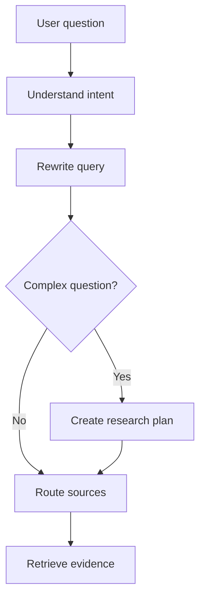
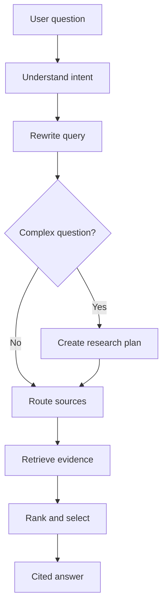

# 02 — First Principles of an Answer Engine

> **Part I — First Principles — Chapter 2**
> Subproject: `docs/02-first-principles-answer-engine/index.md`

---

## 1. First-Principle Question

Why can an LLM not safely answer factual questions from memory alone, and what must replace memory as the basis of an answer?

---

## 2. Mental Model

Knowledge (parametric, in weights) differs from retrieval (explicit, sourced evidence) and reasoning (combining evidence into conclusions). A question is not a prompt to free-associate; it is a request for a claim backed by a source. Evidence-first answering means the model writes from an evidence packet, not from memory. Trustworthy answers are supported, current, and citable. The three failure modes are wrong (false claim), unsupported (no source), and stale (outdated fact).

---

## 3. How Perplexity-Style Systems Work

Perplexity uses retrieval, ranking, snippet selection, and citation-grounded synthesis. The model is constrained over selected evidence. The answer engine loop: understand the question → rewrite/decompose → route sources → retrieve → rank → select evidence → synthesize → cite → verify.

Source: [Perplexity Help Center](https://www.perplexity.ai/help-center/en/articles/10352895-how-does-perplexity-work)

---

## 4. Local-First Adaptation

The same loop runs against a local index first. Question understanding, rewriting, and routing happen locally or via an explicitly permitted model. Retrieval queries the local vector/keyword index; web is a secondary route. Evidence packets carry local provenance (file path, page number) so citations point to files on the user's device.

---

## 5. Architecture Diagram

---

## 6. Design Decisions

| Decision | Choice | Rationale |
|---|---|---|
| Basis of answers | Evidence packet, not model weights | Prevents hallucination from memory |
| Question handling | Rewrite + decompose + route | Complex questions need subquestions and source routing |
| Trust criteria | Supported, current, citable | Maps to the three failure modes |
| Stop condition | Sufficient evidence or max rounds | Prevents infinite research |

---

## 7. Failure Modes

| Failure | Consequence | Safeguard |
|---|---|---|
| Wrong | False claim presented as fact | Claim-to-source matching + verifier |
| Unsupported | Claim with no citation | Citation enforcement; "not found" allowed |
| Stale | Outdated fact treated as current | Date filtering + freshness signals |

---

## 8. Design Rules

1. A question is not a prompt; it is a research request.
2. Separate knowledge, retrieval, and reasoning explicitly.
3. Evidence-first: the model writes from retrieved passages only.
4. Every factual claim needs a citation or an "insufficient evidence" note.
5. Track confidence and uncertainty explicitly.

---

## 9. Checkpoint

- [ ] Question lifecycle stages identified (understand → rewrite → decompose → route → retrieve)
- [ ] Three failure modes defined: wrong, unsupported, stale
- [ ] Evidence-first answering established as the core rule
- [ ] Trust criteria: supported, current, citable