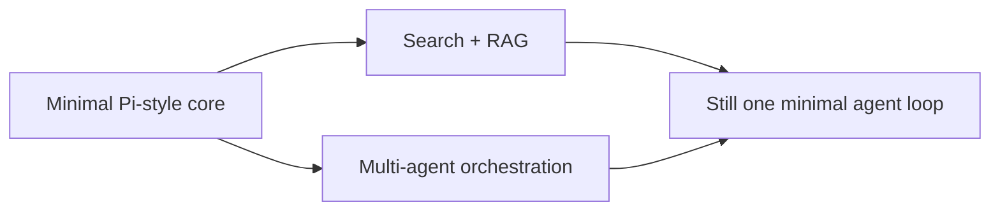
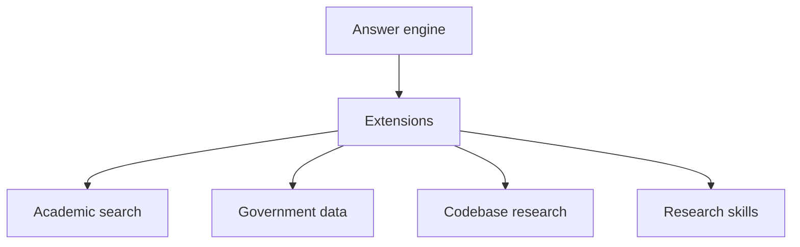

# 03 — The LocalPerplex Design Philosophy

> **Part I — First Principles — Chapter 3**
> Subproject: `docs/03-design-philosophy/index.md`

---

## 1. First-Principle Question

What organising principles keep an answer engine minimal, private, and trustworthy instead of becoming a bloated, opaque agent?

---

## 2. Mental Model

LocalPerplex treats the answer engine as a small kernel: one minimal agent loop, retrieval as a tool layer, multi-agent behaviour as an orchestration layer on top — never a replacement for the core. Citations are first-class, not an afterthought. Local and web are equal sources with explicit provenance. The human stays in control of research; the agent assists but does not act autonomously without oversight.

---

## 3. How Perplexity-Style Systems Work

Perplexity's architecture uses hybrid retrieval, multi-stage ranking, reranking, and citation-oriented generation. Enterprise internal-knowledge search combines internal files and the web, selecting relevant sections and citing them. The system is a constrained synthesizer over evidence, not an unrestricted generator.

Source: [Perplexity Photon blog](https://www.perplexity.ai/en-GB/hub/blog/photon)

---

## 4. Local-First Adaptation

Privacy by architecture: user data stays on the device by default. Local and web sources are treated equally with clear provenance labels. Research is human-controlled — the planner proposes, the researcher retrieves, the critic checks, the writer answers, but the human approves the research plan and can intervene. We deliberately do not build a giant autonomous agent first; we add capabilities incrementally (V1→V5).

---

## 5. Architecture Diagram

---

## 6. Design Decisions

| Decision | Choice | Rationale |
|---|---|---|
| Core size | Minimal kernel | Avoids monolith; easy to audit and extend |
| Extensibility | Tool layer + orchestration layer | Retrieval and multi-agent are add-ons, not core replacements |
| Citations | First-class feature | Verifiability is the product differentiator |
| Source equality | Local and web equal, explicit provenance | No silent preference; user knows where claims come from |
| Agent growth | Start sequential, add parallel later | Controlled complexity; avoid autonomous runaway |

---

## 7. Failure Modes

| Failure | Consequence | Safeguard |
|---|---|---|
| Giant agent first | Unmaintainable monolith | Build V1→V5 incrementally |
| Citations optional | Unverifiable answers | Citations mandatory in system prompt |
| Opaque routing | User distrust | Explicit local/web toggle and provenance |
| Autonomous agents | Unintended actions | Human-in-the-loop; max research rounds |

---

## 8. Design Rules

1. Minimal core, extensible research workflows.
2. Privacy by architecture; data stays local by default.
3. Citations are a first-class product feature.
4. Local and web are equal sources with explicit provenance.
5. Human-controlled research; agent assists, never acts alone.
6. Start with three roles, not ten.

---

## 9. Checkpoint

- [ ] Design philosophy articulated (kernel analogy, privacy, citations, human control)
- [ ] Build order V1→V5 defined
- [ ] Extension points identified (tools, skills, connectors)
- [ ] Failure modes and safeguards documented