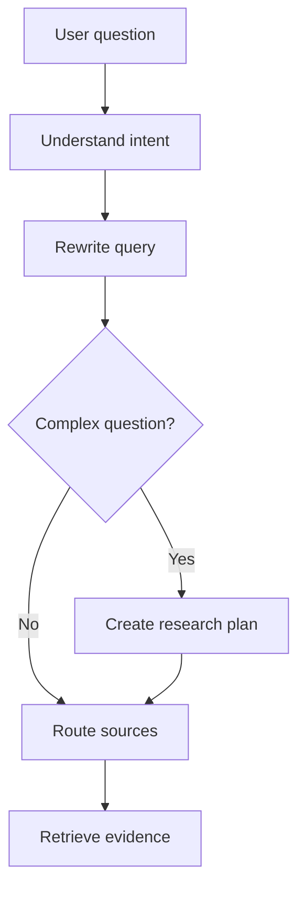
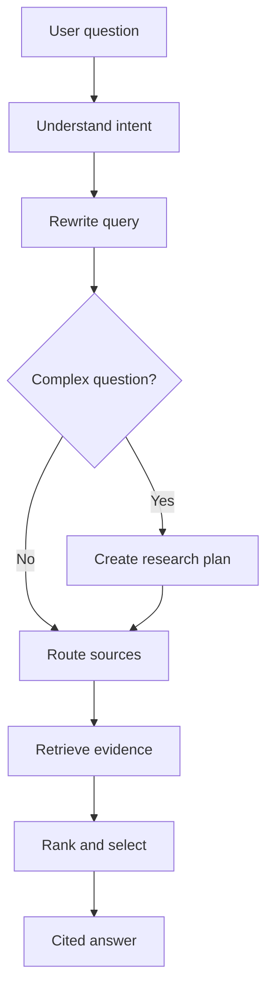

# 04 — The Question Lifecycle

> **Part II — The Answer Engine Core — Chapter 4**
> Subproject: `docs/04-question-lifecycle/index.md`

---

## 1. First-Principle Question

How does a raw user question become a bounded research plan with a clear stop condition, rather than an open-ended, unbounded search?

---

## 2. Mental Model

A question flows through distinct stages: understand intent, rewrite the query, decompose if complex, route to sources, and retrieve. Each stage narrows the scope. Decomposition splits a complex question into subquestions with their own source routes. The research plan captures subquestions, sources, order, and completion criteria. The agent stops when evidence is sufficient or a round budget is exhausted.

---

## 3. How Perplexity-Style Systems Work

Perplexity interprets the question, searches the web, retrieves sources, and synthesizes a cited answer. Question interpretation includes understanding intent and rewriting. Complex questions are decomposed into subqueries. Source routing decides local vs web vs hybrid. The loop ends with citation-grounded synthesis.

Source: [Perplexity Help Center](https://www.perplexity.ai/help-center/en/articles/10352895-how-does-perplexity-work)

---

## 4. Local-First Adaptation

Intent classification and query rewriting run on-device (or via explicitly permitted model). Routing prefers the local index first; web is a fallback or hybrid addition. Decomposition produces subquestions each tagged with a source route (local/web/both). The research plan is stored as structured state in the research thread so it can be inspected and edited by the human.

---

## 5. Architecture Diagram

---

## 6. Design Decisions

| Decision | Choice | Rationale |
|---|---|---|
| Intent classification | Local classifier or small model | Fast, private, no round-trip for routing |
| Query rewriting | Expand synonyms + disambiguate | Improves recall without changing meaning |
| Decomposition threshold | Heuristic + model signal | Avoid over-splitting simple questions |
| Source routing | Local-first, web fallback | Privacy default; web only when needed |
| Stop condition | Sufficient evidence or max rounds (default 5) | Prevents infinite research loops |

---

## 7. Failure Modes

| Failure | Consequence | Safeguard |
|---|---|---|
| Misclassified intent | Wrong source route | Human-visible route; override toggle |
| Over-decomposition | Too many subquestions, wasted cost | Simple planner rules; max subquestions |
| Under-decomposition | Complex question not fully answered | Critic flags missing subquestions |
| No stop condition | Infinite research | Max research rounds + evidence sufficiency check |

---

## 8. Design Rules

1. Route before retrieving; never search everywhere at once.
2. Decompose only when the question is genuinely complex.
3. Each subquestion gets its own source route and evidence packet.
4. The research plan is inspectable and editable by the human.
5. Stop when evidence is sufficient or the round budget is exhausted.

---

## 9. Checkpoint

- [ ] Question lifecycle stages defined (understand → rewrite → decompose → route → retrieve)
- [ ] Intent classification and source routing specified
- [ ] Decomposition rules and stop conditions defined
- [ ] Research plan structure (subquestions, sources, order, completion) documented