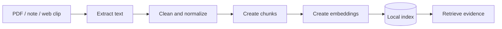
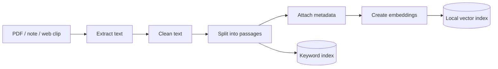

# 05 — Local Knowledge Base

> **Part II — The Answer Engine Core — Chapter 5**
> Subproject: `docs/05-local-knowledge-base/index.md`

---

## 1. First-Principle Question

How do personal files (PDFs, notes, code, saved pages) become a queryable, citable local index without sending content off-device?

---

## 2. Mental Model

The local knowledge base is the heart of private RAG. It ingests files through a pipeline: extract text → clean → chunk → attach metadata → embed → index. Each chunk carries metadata (source ID, path/URL, page number, title, date, tags, author) so every retrieved passage can be cited back to its origin. Hybrid retrieval combines keyword and semantic search over the same index.

---

## 3. How Perplexity-Style Systems Work

Perplexity's enterprise internal-knowledge search combines internal files and the web, selecting relevant sections and citing them. RAG systems split documents into smaller passages before indexing; chunking is a standard part of the indexing stage. Hybrid retrieval (keyword + semantic) and multi-stage ranking are used to surface the right passages.

Sources: [Perplexity Photon blog](https://www.perplexity.ai/en-GB/hub/blog/photon), [RAG indexing arxiv](https://arxiv.org/html/2507.18910v1)

---

## 4. Local-First Adaptation

All ingestion happens on-device: PDF parsing, text extraction, cleaning, chunking, embedding, and indexing never leave the machine. Metadata preserves local provenance (absolute file path, page number, modification date). The index is stored locally (file-based or embedded vector store). Web clippings are captured with source URL and fetch date. No content is uploaded unless the user explicitly enables web/cloud mode.

---

## 5. Architecture Diagram

---

## 6. Design Decisions

| Decision | Choice | Rationale |
|---|---|---|
| Accepted formats | PDF, Markdown, text, code, web clips, saved articles | Covers personal knowledge sources |
| Text extraction | Preserve page numbers, headings, tables, footnotes, source path/URL | Needed for accurate citations |
| Cleaning | Remove repeated headers, nav text, ads, broken chars, boilerplate | Improves signal-to-noise in retrieved chunks |
| Chunking | One idea per chunk, with overlap; preserve section title + page + source ID | Keeps context while avoiding split answers |
| Embeddings | Local embedding model; vector index | Privacy; no content leaves device |
| Keyword index | BM25-style over chunk text | Catches exact terms (function names, errors, URLs) |
| Hybrid retrieval | Keyword + semantic, merged and reranked | Best recall + precision |

---

## 7. Failure Modes

| Failure | Consequence | Safeguard |
|---|---|---|
| Bad chunking | Answer split across chunks; poor recall | Semantic chunking with overlap |
| Poor embeddings | Wrong retrieval | Hybrid search (keyword + semantic) |
| Missing metadata | Uncitable chunks | Mandatory metadata fields per chunk |
| Stale index | Deleted/edited files still indexed | Local index updates on file change |
| Large documents blow context | Context overflow | Chunk size limits; evidence packet limits |

---

## 8. Design Rules

1. Every chunk carries source ID, path/URL, page number, title, date, tags, author.
2. Preserve page numbers and section headings for citations.
3. Chunk by idea, not by fixed size; keep overlap for boundary context.
4. Use hybrid retrieval: keyword + semantic.
5. Update the index when files change; never serve stale chunks.

---

## 9. Checkpoint

- [ ] Ingestion pipeline stages defined (extract → clean → chunk → metadata → embed → index)
- [ ] Accepted file formats listed (PDF, MD, text, code, web clips)
- [ ] Metadata schema defined with citation-critical fields
- [ ] Chunking rules (one idea, overlap, section + page + source ID) specified
- [ ] Hybrid retrieval (keyword + semantic) selected