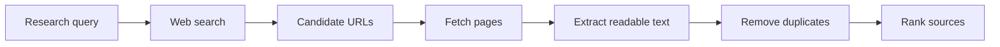
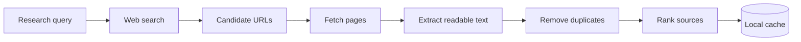

# 06 — Web Research Layer

> **Part II — The Answer Engine Core — Chapter 6**
> Subproject: `docs/06-web-research-layer/index.md`

---

## 1. First-Principle Question

When the local knowledge base is insufficient, how does the system safely fetch, extract, and rank live web evidence without compromising privacy or injecting untrusted content?

---

## 2. Mental Model

The web research layer turns a research query into candidate URLs, fetches pages, extracts readable text, deduplicates, and ranks sources. It applies freshness/date filtering, source-quality signals, and domain allow/blocklists. Results are cached for offline research. Web access is opt-in and can be disabled entirely for air-gapped or sensitive workflows.

---

## 3. How Perplexity-Style Systems Work

Perplexity generates search queries, retrieves results, fetches pages, extracts readable text, deduplicates, and ranks sources before synthesis. The web layer is a separate stage from the local index, merged later in hybrid retrieval.

Source: [Perplexity Help Center](https://www.perplexity.ai/help-center/en/articles/10352895-how-does-perplexity-work)

---

## 4. Local-First Adaptation

Web search is an explicit, opt-in tool (`search_web`) gated by a local/web toggle. Fetch results carry full provenance (URL, fetch date, domain) so citations point back to the live page. Caching stores fetched pages locally for offline reuse. Domain allowlists/blocklists let the user restrict which sites can be consulted. Prompt injection from fetched pages is mitigated by treating page text as untrusted evidence, not instructions.

---

## 5. Architecture Diagram

---

## 6. Design Decisions

| Decision | Choice | Rationale |
|---|---|---|
| Web access | Opt-in, user-controlled toggle | Privacy; user decides when data leaves device |
| Search provider | Pluggable (configurable) | Avoid vendor lock-in; allow local SearXNG etc. |
| Page extraction | Readable-text extraction (reader mode) | Strip ads/nav/boilerplate; keep article text |
| Deduplication | URL + near-duplicate text | Avoid redundant evidence in packet |
| Freshness | Date filtering + recency boost | Current answers for time-sensitive questions |
| Source quality | Domain authority + allow/blocklists | Filter misinformation and low-quality sites |
| Caching | Local cache of fetched pages | Offline research; reduce repeat fetches |
| Disabled web | Air-gapped mode supported | Fully local-only operation possible |

---

## 7. Failure Modes

| Failure | Consequence | Safeguard |
|---|---|---|
| Stale web data | Wrong current answer | Date filtering + freshness signals |
| Low-quality source | Misinformation | Source-quality ranking + blocklists |
| Prompt injection | Malicious page alters behavior | Treat page text as evidence, not instructions |
| Fetch failure | Missing evidence | Graceful degradation; report source unavailable |
| No web permission | Cannot answer current-events questions | Clear offline indicator; suggest local-only |

---

## 8. Design Rules

1. Web access is explicit and opt-in; never automatic.
2. Every web result carries URL, fetch date, and domain for citation.
3. Strip ads/navigation/boilerplate before indexing page text.
4. Deduplicate by URL and near-duplicate content.
5. Apply date filtering and source-quality signals.
6. Support domain allowlists and blocklists.
7. Cache fetched pages locally for offline research.
8. Provide a clear offline indicator when web is disabled.

---

## 9. Checkpoint

- [ ] Web research pipeline defined (search → fetch → extract → dedup → rank)
- [ ] Opt-in web access with local/web toggle specified
- [ ] Provenance fields (URL, fetch date, domain) defined for citations
- [ ] Freshness, quality signals, and allow/blocklists specified
- [ ] Caching and offline mode documented
- [ ] Prompt injection safeguard stated