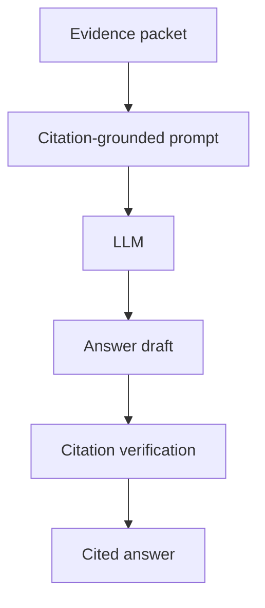
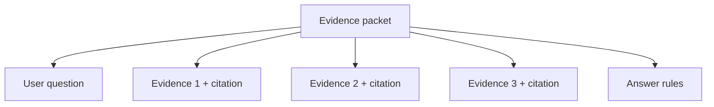

# 08 — Citation-Grounded Answer Generation

> **Part II — The Answer Engine Core — Chapter 8**
> Subproject: `docs/08-citation-grounded-answer/index.md`

---

## 1. First-Principle Question

How does the model produce an answer where every important claim is traceable to a specific evidence item, and what happens when evidence is missing or conflicts?

---

## 2. Mental Model

The answer contract is: use only provided evidence for factual claims, attach a citation to each important claim, say "not found in sources" when evidence is insufficient, distinguish facts from interpretation, and show conflicting evidence rather than hiding it. The evidence packet (question + evidence items + rules) is turned into a citation-grounded system prompt. The model drafts, then citation verification checks claim-to-source mapping before the final cited answer is delivered.

---

## 3. How Perplexity-Style Systems Work

Perplexity returns a conversational answer with citations, where the model is a constrained synthesizer over selected evidence. Research systems increasingly use citation-guided generation, producing claim-citation pairs so answers remain grounded.

Sources: [Perplexity Help Center](https://www.perplexity.ai/help-center/en/articles/10352895-how-does-perplexity-work), [TREC RAG research](https://trec.nist.gov/pubs/trec34/papers/ii_research.rag.pdf)

---

## 4. Local-First Adaptation

The system prompt enforces evidence-only generation and is constructed locally. Each evidence item carries passage text, source title, URL/file path, page number, date, retrieval score, and citation ID. Inline citations reference the citation ID and resolve to a source list with file paths or URLs. Local provenance (file path, page) is preferred; web provenance (URL, fetch date) is used for web items. The verifier runs locally or via the same model invocation with a verification prompt.

---

## 5. Architecture Diagram

---

## 6. Design Decisions

| Decision | Choice | Rationale |
|---|---|---|
| Evidence items | Passage + title + path/URL + page + date + score + citation ID | Full citability |
| Citation format | Inline `[1]` resolving to source list | Verifiable without clutter |
| Answer styles | Quick / detailed / research | Match user intent depth |
| Insufficient evidence | "Not found in sources" response | No silent guessing |
| Conflicting evidence | Show both sides with citations | Transparency over false consensus |
| Verifier | Separate verification pass | Catches unsupported claims before delivery |

---

## 7. Failure Modes

| Failure | Consequence | Safeguard |
|---|---|---|
| Missing citation | Unverifiable answer | Citation enforcement in system prompt |
| Hallucination | False claim from memory | Evidence-only prompt; "not found" allowed |
| Unsupported claim | Claim with no source | Claim-to-source matching + verifier |
| Conflicting evidence hidden | False consensus | Show contradictions explicitly |
| Context overflow | Poor generation | Small evidence packet limit |

---

## 8. Design Rules

1. Use only provided evidence for factual claims.
2. Attach a citation to each important claim.
3. Say "not found in sources" when evidence is insufficient.
4. Distinguish facts from interpretation.
5. Show conflicting evidence rather than hiding it.
6. Every citation resolves to a source list entry (file path or URL).

---

## 9. Checkpoint

- [ ] Answer contract defined (evidence-only, cite claims, say not-found, facts vs interpretation, show conflicts)
- [ ] Evidence packet structure specified (question + items + rules)
- [ ] Citation format defined (inline ID + source list)
- [ ] Anti-hallucination rules documented
- [ ] Answer styles (quick/detailed/research) specified
- [ ] Verification step (claim-to-source mapping) defined