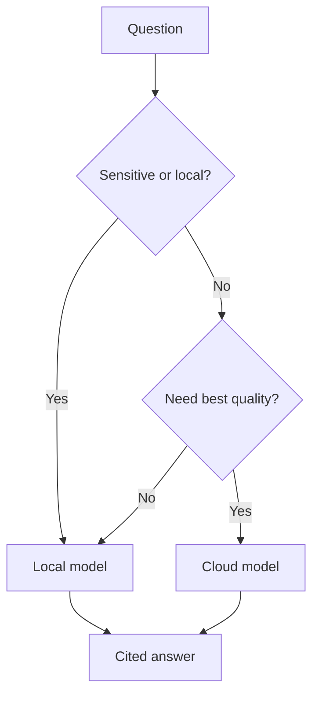

# 09 — Local Models and Privacy

> **Part III — The Local Computer Layer — Chapter 9**
> Subproject: `docs/09-local-models-privacy/index.md`

---

## 1. First-Principle Question

Which tasks must run on-device to preserve privacy, and when is it acceptable to route to a cloud model for quality?

---

## 2. Mental Model

Local models keep everything on the device: question understanding, retrieval, synthesis, and verification never leave the machine. Cloud models offer higher quality for complex synthesis but require sending the evidence packet (not raw files) off-device. Hybrid routing decides per task: sensitive/local → local model; non-sensitive + best quality needed → cloud model. Model selection is task-aware: small models for routing/filtering, larger models for synthesis and verification. What must never leave the device: raw file contents, personal identifiers, unsanctioned context, audit-relevant data without consent.

---

## 3. How Perplexity-Style Systems Work

Perplexity primarily uses cloud models for synthesis over web evidence. Local-first answer engines invert this default: local model for private knowledge, cloud only when the user explicitly permits and quality demands it. Model selection by task balances cost, latency, and quality.

---

## 4. Local-First Adaptation

Routing is governed by a privacy boundary: if the question or evidence is sensitive or local-only, use the local model. Otherwise, offer a choice: best quality (cloud) or local (private). The evidence packet, not full documents, is what may be sent to the cloud. Explicit cloud consent is required before any context leaves the device. Model selection is task-aware: classifier/ranker = small local model; synthesizer = larger local or cloud; verifier = local or cloud depending on sensitivity.

---

## 5. Architecture Diagram

---

## 6. Design Decisions

| Decision | Choice | Rationale |
|---|---|---|
| Default model | Local | Privacy by default |
| Cloud routing | Opt-in, per-query consent | User controls data leaving device |
| What may go to cloud | Evidence packet only (not raw files) | Minimise exposure |
| Model by task | Small for route/filter; large for synthesise/verify | Cost/latency/quality trade-off |
| Sensitive data | Never leaves device | Hard privacy boundary |
| Local model format | Quantised, runnable on device | Feasible on consumer hardware |

---

## 7. Failure Modes

| Failure | Consequence | Safeguard |
|---|---|---|
| Cloud leak | Private data exposed | Explicit consent; evidence packet only |
| Local model too weak | Poor synthesis quality | Fallback to cloud with consent; task-aware selection |
| High latency | Slow answers | Small local models for simple tasks |
| Cost overrun | Expensive cloud calls | Local default; cloud opt-in with budget |

---

## 8. Design Rules

1. Local model is the default; cloud is explicit opt-in.
2. Only the evidence packet may leave the device, never raw files.
3. Explicit cloud consent before any context is sent.
4. Route by task: small models for classify/filter, larger for synthesise/verify.
5. What must never leave the device: raw contents, personal identifiers, unsanctioned context.
6. Provide cost/latency/quality trade-off visibility to the user.

---

## 9. Checkpoint

- [ ] Local-vs-cloud routing decision defined (privacy boundary)
- [ ] What may/must never leave the device enumerated
- [ ] Model selection by task (classify/filter vs synthesise/verify)
- [ ] Explicit cloud consent mechanism specified
- [ ] Cost/latency/quality trade-offs documented