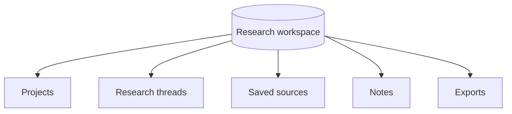

# 10 — The Research Workspace

> **Part III — The Local Computer Layer — Chapter 10**
> Subproject: `docs/10-research-workspace/index.md`

---

## 1. First-Principle Question

How does the user organise, save, and revisit research across sessions instead of treating each question as a disposable chat?

---

## 2. Mental Model

A workspace is the durable container for research: projects, collections, and tags group related work; research threads hold question-answer sessions with their evidence packets; saved answers and sources are revisitable; notes and highlights let the user annotate evidence; research history is searchable; exports to Markdown and PDF let the user share findings; versioning tracks how an answer evolved over time.

---

## 3. How Perplexity-Style Systems Work

Perplexity offers threads and libraries for saved searches. LocalPerplex extends this with local persistence, versioning, and export — the research is owned by the user, not the service.

---

## 4. Local-First Adaptation

The workspace lives entirely on the device: projects, threads, sources, notes, and exports are stored locally. Sessions map to research threads with tree-structured history (parent/child forking). Saved evidence carries full provenance for later re-citation. Export to Markdown and PDF is local. Versioning snapshots the evidence packet and answer at each stage so the user can diff how conclusions changed.

---

## 5. Architecture Diagram

---

## 6. Design Decisions

| Decision | Choice | Rationale |
|---|---|---|
| Workspace location | Local file system | Privacy and ownership |
| Thread model | Tree-structured sessions (parent/child) | Forking and revisiting research paths |
| Saved sources | Evidence packets + metadata | Re-citable later |
| Export formats | Markdown and PDF | Universal, local rendering |
| Versioning | Snapshot evidence packet + answer per stage | Diff research evolution |
| Tags/collections | User-defined | Flexible organisation |

---

## 7. Failure Modes

| Failure | Consequence | Safeguard |
|---|---|---|
| Lost research | Work not reproducible | Local persistence + export |
| Orphaned sources | Cannot re-cite | Provenance stored with every saved source |
| No versioning | Cannot see how answer changed | Snapshots per research stage |
| Hard to find past work | Duplicate research | Searchable history + tags/collections |

---

## 8. Design Rules

1. Workspace is local-first; all research data stored on device.
2. Research threads are tree-structured (forkable, revisitable).
3. Every saved source carries full provenance for re-citation.
4. Export to Markdown and PDF is local and offline.
5. Version snapshots capture evidence packet + answer per stage.
6. Projects, collections, and tags are user-defined.

---

## 9. Checkpoint

- [ ] Workspace structure defined (projects, threads, sources, notes, exports)
- [ ] Thread model (tree-structured, forkable) specified
- [ ] Saved sources with provenance for re-citation
- [ ] Export formats (Markdown, PDF) defined
- [ ] Versioning approach (snapshots per stage) documented