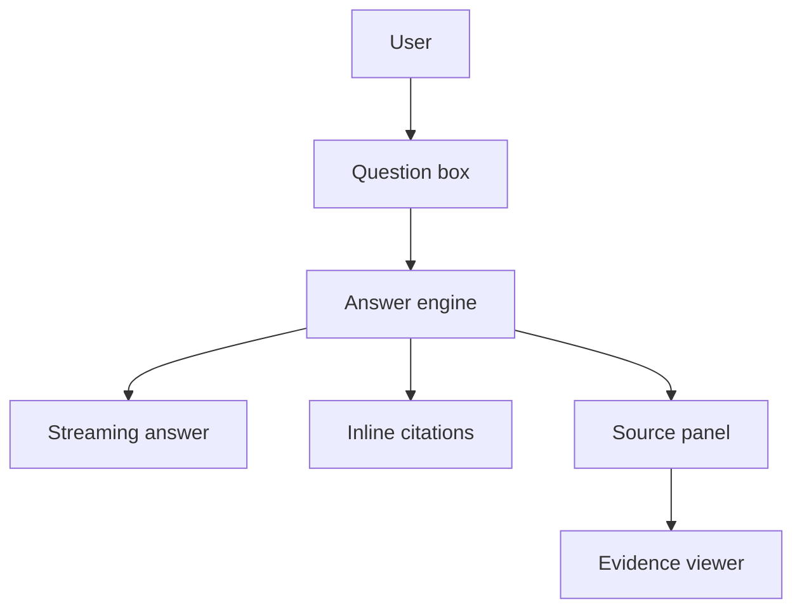

# 11 — The Local Interface

> **Part III — The Local Computer Layer — Chapter 11**
> Subproject: `docs/11-local-interface/index.md`

---

## 1. First-Principle Question

How does the user interact with the answer engine so that citations, sources, and evidence are visible and inspectable rather than hidden behind a chat bubble?

---

## 2. Mental Model

The interface centres on the question box, with a streaming cited answer as the primary output. Inline citations resolve to a source panel and an evidence viewer where the user can open the original file or page. Follow-up questions continue the research thread. A local/web toggle switches modes. Search history and an offline indicator keep the user informed about where answers come from and whether web access is available.

---

## 3. How Perplexity-Style Systems Work

Perplexity shows cited answers with source footnotes. LocalPerplex extends this with an evidence viewer, local/web toggle, offline indicator, and source panel that links back to local files (path + page) as well as web URLs.

---

## 4. Local-First Adaptation

The interface is a desktop app or terminal client running locally. The question box routes to the answer engine. Streaming answers render inline citations that expand into a source panel. The evidence viewer shows the exact passage, source title, file path/URL, page number, and date. Follow-up questions reference the current thread's evidence. The local/web toggle is persistent and visible. Search history shows past questions with their answer mode (local/web/hybrid). An offline indicator appears when web is disabled or unavailable.

---

## 5. Architecture Diagram

---

## 6. Design Decisions

| Decision | Choice | Rationale |
|---|---|---|
| Interface type | Desktop app or terminal | Local-first, offline-capable |
| Primary output | Streaming cited answer | Immediate feedback + verifiability |
| Citation rendering | Inline IDs expanding to source panel | Verifiable without clutter |
| Evidence viewer | Passage + title + path/URL + page + date | Inspect source directly |
| Local/web toggle | Persistent, visible | User controls mode explicitly |
| Offline indicator | Visible when web unavailable | Clear status, no silent failure |

---

## 7. Failure Modes

| Failure | Consequence | Safeguard |
|---|---|---|
| Hidden citations | Unverifiable answer | Inline citations + source panel mandatory |
| Broken source link | Cannot inspect evidence | Store path/URL + page; show "source unavailable" |
| Silent web disable | User thinks answer is local when it isn't | Offline indicator + visible local/web toggle |
| No follow-up context | Lost thread state | Research thread persists evidence across turns |

---

## 8. Design Rules

1. Every important claim has an inline citation resolving to the source panel.
2. The evidence viewer shows full provenance (path/URL, page, date).
3. Local/web toggle is visible and persistent.
4. Offline indicator shows when web is unavailable.
5. Follow-up questions carry the research thread's evidence context.
6. Search history records answer mode per question.

---

## 9. Checkpoint

- [ ] Interface components defined (question box, streaming answer, citations, source panel, evidence viewer)
- [ ] Inline citation → source panel → evidence viewer flow specified
- [ ] Local/web toggle and offline indicator specified
- [ ] Follow-up question / research thread persistence defined
- [ ] Search history with answer mode documented