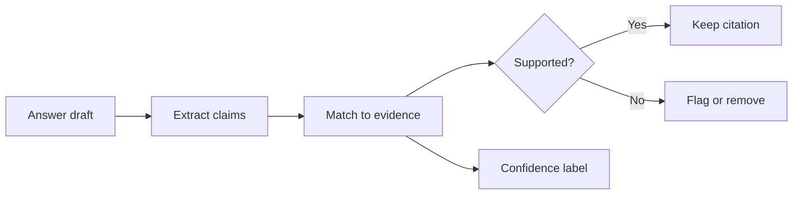

# 12 — Citation Verification

> **Part IV — Reliability, Trust, and Extensions — Chapter 12**
> Subproject: `docs/12-citation-verification/index.md`

---

## 1. First-Principle Question

How does the system detect and remove citations that the model generated but cannot be traced back to the evidence packet, so the user never receives a fabricated source?

---

## 2. Mental Model

Generated citations can be wrong: the model may cite a source that doesn't contain the claim, or fabricate a citation ID. Verification extracts claims from the answer draft, matches each to evidence, verifies quotes against the source text, detects unsupported claims, and either keeps, flags, or removes each citation. Confidence labels indicate how well each claim is supported. A human review workflow lets the user override automated decisions. Citation quality metrics track precision and recall over time.

---

## 3. How Perplexity-Style Systems Work

Perplexity returns cited answers but does not expose a verification step to the user. LocalPerplex makes verification explicit: claim extraction → claim-to-source matching → quote verification → supported/unsupported decision → confidence label.

---

## 4. Local-First Adaptation

Verification runs locally on the evidence packet and answer draft. Claim-to-source matching compares each claim against the retrieved passages (text overlap + semantic similarity). Quote verification checks that quoted text appears verbatim in the source. Unsupported claims are flagged or removed; the critic can trigger more research. Confidence labels (high/medium/low) are shown next to citations. Human review lets the user accept, edit, or reject each verification result.

---

## 5. Architecture Diagram

---

## 6. Design Decisions

| Decision | Choice | Rationale |
|---|---|---|
| Claim extraction | LLM-based or rule-based | Extract atomic factual claims |
| Claim-to-source matching | Text overlap + semantic similarity | Robust to paraphrase |
| Quote verification | Verbatim substring check against source | Prevents fabricated quotes |
| Unsupported claim handling | Flag or remove | User-configurable strictness |
| Confidence labels | High / medium / low | Transparency on citation strength |
| Human review | Accept / edit / reject per citation | Final authority rests with user |
| Quality metrics | Citation precision, recall, support rate | Track verification over time |

---

## 7. Failure Modes

| Failure | Consequence | Safeguard |
|---|---|---|
| Citation to wrong source | Misleading attribution | Claim-to-source matching |
| Fabricated quote | False evidence | Verbatim quote verification |
| Unsupported claim kept | Unverifiable answer | Critic flags; remove option |
| Over-strict removal | Loses valid claims | Confidence labels; human override |
| Verifier itself hallucinates | Wrong accept/reject | Human review workflow |

---

## 8. Design Rules

1. Extract claims from the answer draft before verification.
2. Match each claim to evidence via text overlap + semantic similarity.
3. Verify quotes are verbatim in the source.
4. Flag or remove unsupported claims (user-configurable).
5. Assign confidence labels (high/medium/low) per citation.
6. Provide a human review workflow (accept/edit/reject).
7. Track citation quality metrics over time.

---

## 9. Checkpoint

- [ ] Verification pipeline defined (claims → match → verify → decide)
- [ ] Claim-to-source matching approach specified
- [ ] Quote verification (verbatim check) defined
- [ ] Unsupported claim handling (flag/remove) specified
- [ ] Confidence labels (high/medium/low) defined
- [ ] Human review workflow (accept/edit/reject) specified
- [ ] Citation quality metrics identified