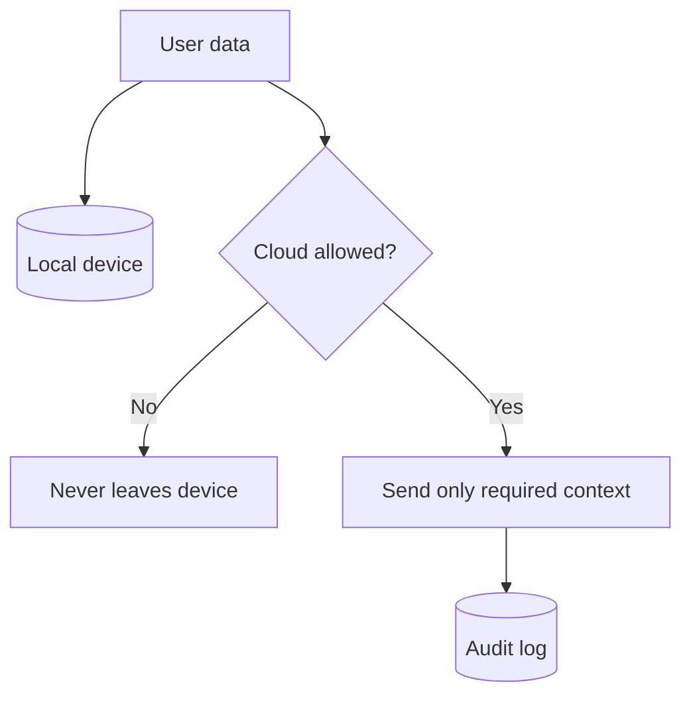

# 13 — Safety, Privacy, and Trust

> **Part IV — Reliability, Trust, and Extensions — Chapter 13**
> Subproject: `docs/13-safety-privacy-trust/index.md`

---

## 1. First-Principle Question

What boundaries keep user data private, what may be sent to the cloud, and how does the system defend against malicious documents and prompt injection from the web?

---

## 2. Mental Model

The privacy model is local-first: user data stays on the device by default. Cloud is allowed only with explicit consent and only the minimal required context (the evidence packet, not raw files). Source trust and misinformation are handled via quality ranking and blocklists. Prompt injection from web pages is mitigated by treating fetched page text as untrusted evidence, not instructions. Malicious documents are sandboxed during extraction. Data retention is user-controlled. Auditability logs what was sent, when, and why. Human oversight is required for cloud routing.

---

## 3. How Perplexity-Style Systems Work

Perplexity sends queries and evidence to cloud models by default. LocalPerplex inverts this: nothing leaves the device unless explicitly permitted. The local-first privacy model means local-only mode is the default and web/cloud is opt-in.

---

## 4. Local-First Adaptation

All ingestion, indexing, retrieval, and synthesis run locally by default. The local/web toggle governs whether any network call occurs. Cloud consent is explicit and per-session or per-query. When cloud is used, only the evidence packet (passages + citations, not full files) is sent. Prompt injection defences: fetched web content is sanitised and tagged as untrusted evidence; the system prompt instructs the model not to treat evidence as instructions. Malicious documents are handled with safe extraction (timeouts, size limits, no code execution). Audit logs record every cloud send and every web fetch.

---

## 5. Architecture Diagram

---

## 6. Design Decisions

| Decision | Choice | Rationale |
|---|---|---|
| Default privacy mode | Local-only | Data never leaves device unless permitted |
| Cloud consent | Explicit, per query or session | User controls data egress |
| What may go to cloud | Evidence packet only | Minimise exposure |
| Prompt injection defence | Treat web text as untrusted evidence | Sanitise + system-prompt instruction |
| Malicious documents | Safe extraction (timeouts, size limits, no code exec) | Sandbox ingestion |
| Data retention | User-controlled; local deletion available | User owns data lifecycle |
| Auditability | Log cloud sends, web fetches, model routing | Traceability |
| Human oversight | Required for cloud routing | No silent data egress |

---

## 7. Failure Modes

| Failure | Consequence | Safeguard |
|---|---|---|
| Silent cloud send | Private data exposed | Explicit consent + audit log |
| Prompt injection | Malicious page alters behaviour | Sanitise evidence; system-prompt rules |
| Malicious document | Code execution during extraction | Safe extraction; no code exec; size/time limits |
| Misinformation source | Wrong answer | Source-quality ranking + blocklists |
| No audit trail | Untraceable data egress | Audit log for every cloud/web action |

---

## 8. Design Rules

1. Local-first privacy: data stays on device by default.
2. Cloud only with explicit user consent.
3. Only the evidence packet may leave the device (not raw files).
4. Treat all web-fetched text as untrusted evidence, not instructions.
5. Sanitise fetched pages; block prompt injection patterns.
6. Safe extraction for documents (timeouts, size limits, no code execution).
7. Audit log every cloud send and web fetch.
8. Human oversight required for cloud routing.

---

## 9. Checkpoint

- [ ] Local-first privacy model defined
- [ ] Explicit cloud consent mechanism specified
- [ ] What may/must never leave the device enumerated
- [ ] Prompt injection defences (sanitise + system prompt) specified
- [ ] Malicious document handling (safe extraction) defined
- [ ] Audit log and human oversight specified