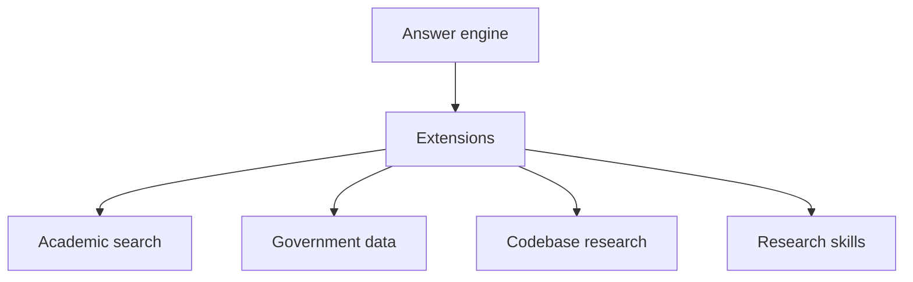

# 14 — Extensions and Skills

> **Part IV — Reliability, Trust, and Extensions — Chapter 14**
> Subproject: `docs/14-extensions-skills/index.md`

---

## 1. First-Principle Question

How can domain-specific data sources and research workflows be added to LocalPerplex without modifying the core answer engine?

---

## 2. Mental Model

Extensions are pluggable packages that register new tools, connectors, ranking rules, and research templates. Skills are guided, multi-step research workflows encoded in markdown. Custom connectors reach academic-paper search, government data, codebases, and other domain sources. The core answer engine stays unchanged; extensions hook into the tool layer and orchestration layer. The human controls which extensions are installed and which skills run.

---

## 3. How Perplexity-Style Systems Work

Perplexity offers Pro search and focused modes but is a closed service. LocalPerplex is open and extensible: connectors and skills are user-installable, local-first packages.

---

## 4. Local-First Adaptation

Extensions run locally where possible; a connector that must reach the network (academic search, government data) is opt-in and gated by the web consent model. Custom ranking rules let the user bias results toward trusted domains. Research templates encode domain-specific procedures (e.g., "investigate a security incident"). Export workflows let the user publish to Markdown/PDF or external destinations. Skills are stored as markdown files with name, description, and location, loaded into the system prompt like Pi skills.

---

## 5. Architecture Diagram

---

## 6. Design Decisions

| Decision | Choice | Rationale |
|---|---|---|
| Extension mechanism | Register tools + connectors + ranking rules | Core stays unchanged |
| Skills format | Markdown with name/description/location | Loaded into system prompt (Pi pattern) |
| Connector network access | Opt-in, gated by web consent | Privacy preserved |
| Custom ranking rules | User-defined domain/source preferences | Trust bias without hardcoding |
| Research templates | Encoded domain procedures | Reproducible workflows |
| Export workflows | Markdown/PDF + external targets | Flexible publishing |

---

## 7. Failure Modes

| Failure | Consequence | Safeguard |
|---|---|---|
| Malicious extension | Code execution / data leak | User installs only trusted extensions; review code |
| Connector returns bad data | Misinformation | Source-quality ranking + blocklists apply |
| Ranking rule conflict | Biased results | Transparent rule ordering; user-editable |
| Extension breaks core | Answer engine fails | Extensions isolated; core unchanged |

---

## 8. Design Rules

1. Core answer engine is unchanged by extensions.
2. Extensions register tools, connectors, ranking rules, and templates.
3. Skills are markdown (name/description/location) loaded into the prompt.
4. Network-reaching connectors are opt-in under web consent.
5. Custom ranking rules are transparent and user-editable.
6. Research templates encode repeatable domain procedures.

---

## 9. Checkpoint

- [ ] Extension mechanism defined (tools, connectors, ranking rules, templates)
- [ ] Skills format specified (markdown with name/description/location)
- [ ] Connector network access gated by web consent
- [ ] Custom ranking rules specified as transparent and user-editable
- [ ] Research templates and export workflows defined