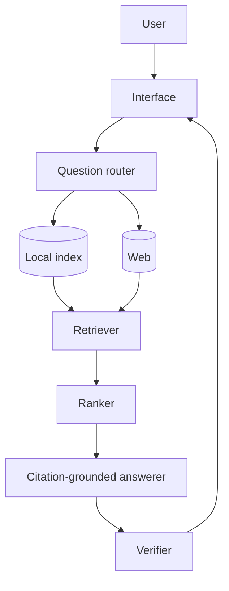

# 16 — Architecture Blueprint

> **Part V — Building LocalPerplex — Chapter 16**
> Subproject: `docs/16-architecture-blueprint/index.md`

---

## 1. First-Principle Question

What is the minimal set of components needed to run the local-first answer engine, and how does data flow end-to-end from question to cited answer?

---

## 2. Mental Model

The minimal component set: user interface, question router, local index, web layer, retriever, ranker, citation-grounded answerer, verifier. Data flow: user asks → router routes to local/web → retrieval → ranking → evidence packet → grounded answer → verification → UI. Event-driven design means each stage emits events (retrieved, ranked, drafted, verified) that extensions and the UI can subscribe to. Local-first boundaries: the index and all local processing stay on-device; web calls are opt-in. Build the router + local index + retriever + answerer first; postpone multi-agent orchestration, local models, and the research workspace.

---

## 3. How Perplexity-Style Systems Work

Perplexity's public architecture: user → UI → question router → local index / web → retriever → ranker → citation-grounded answerer → verifier → UI. Hybrid retrieval, multi-stage ranking, reranking, and citation-oriented generation.

Source: [Perplexity Help Center](https://www.perplexity.ai/help-center/en/articles/10352895-how-does-perplexity-work), [Perplexity Photon blog](https://www.perplexity.ai/en-GB/hub/blog/photon)

---

## 4. Local-First Adaptation

The question router prefers the local index; web is a secondary route gated by consent. The retriever queries the local hybrid index (keyword + semantic). The ranker runs first-stage then reranking. The answerer uses a citation-grounded system prompt built locally. The verifier checks claim-to-source mapping. Event-driven: stages emit typed events so the UI (streaming, source panel) and extensions can react without coupling.

---

## 5. Architecture Diagram

---

## 6. Design Decisions

| Decision | Choice | Rationale |
|---|---|---|
| Component set | UI, router, local index, web, retriever, ranker, answerer, verifier | Minimal end-to-end loop |
| Data flow | Question → route → retrieve → rank → answer → verify → UI | Linear pipeline with feedback for re-research |
| Event-driven | Typed events per stage | UI and extensions subscribe without coupling |
| Local-first boundary | Index + local processing on-device; web opt-in | Privacy default |
| Build order | Router + index + retriever + answerer first | Delivers V1–V3 value quickly |
| Postpone | Multi-agent orchestration, local models, workspace | Higher complexity, later milestones |

---

## 7. Failure Modes

| Failure | Consequence | Safeguard |
|---|---|---|
| Router misroutes | Wrong source searched | Human-visible route; local/web toggle |
| Retriever returns nothing | No evidence to answer | "Not found in sources" response |
| Ranker picks poor evidence | Weak answer | Reranking + evidence packet limits |
| Answerer hallucinates | False claim | Citation-grounded prompt + verifier |
| Verifier misses a bad citation | Fabricated source shipped | Human review + citation quality metrics |

---

## 8. Design Rules

1. One minimal agent loop; retrieval is a tool layer.
2. Route before retrieving; local first, web opt-in.
3. Each pipeline stage emits typed events.
4. The verifier runs before the answer reaches the UI.
5. Keep the answerer's prompt evidence-only (no memory answers).
6. Postpone complexity (orchestration, local models, workspace) until V1–V3 ship.

---

## 9. Checkpoint

- [ ] Minimal component set enumerated (UI, router, local index, web, retriever, ranker, answerer, verifier)
- [ ] End-to-end data flow defined
- [ ] Event-driven design specified (typed events per stage)
- [ ] Local-first boundaries drawn
- [ ] Build-first vs postpone list created
- [ ] Failure modes and safeguards documented