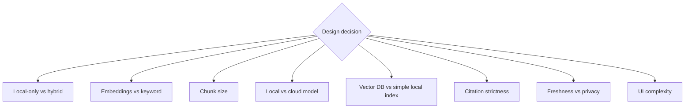

# 18 — Design Decisions and Trade-offs

> **Part V — Building LocalPerplex — Chapter 18**
> Subproject: `docs/18-design-decisions/index.md`

---

## 1. First-Principle Question

Which binary choices shape LocalPerplex, and what are the explicit trade-offs the team accepts for each?

---

## 2. Mental Model

Every design decision is a trade-off: local-only vs hybrid (privacy vs freshness), embeddings vs keyword (meaning vs exact terms), chunk size (context vs precision), local vs cloud model (privacy vs quality), vector DB vs simple local index (operational complexity vs zero infra), citation strictness (verifiability vs answer rate), freshness vs privacy (current answers vs data egress), UI complexity (verifiability vs simplicity). The team documents each choice and its accepted downside.

---

## 3. How Perplexity-Style Systems Work

Perplexity chose hybrid retrieval (keyword + semantic), multi-stage ranking with reranking, cloud models, and web-first. LocalPerplex inverts several: local-first, optional web, local model default, citations mandatory. These are deliberate trade-offs for privacy and verifiability over raw convenience.

Source: [Perplexity Photon blog](https://www.perplexity.ai/en-GB/hub/blog/photon)

---

## 4. Local-First Adaptation

The default answer to each trade-off leans local and private: local-only unless hybrid is explicitly requested; embeddings + keyword (hybrid) not one or the other; moderate chunk size with overlap; local model default with cloud opt-in; simple local index over a managed vector DB; strict citations; freshness only when web is opted in; minimal UI that still shows citations and sources.

---

## 5. Architecture Diagram

---

## 6. Design Decisions

| Decision | Options | Choice | Accepted trade-off |
|---|---|---|---|
| Local-only vs hybrid | Local-only / Hybrid | Hybrid (local-first, web opt-in) | Slightly more complexity for freshness |
| Embeddings vs keyword | Embeddings / Keyword / Hybrid | Hybrid | More infra for better recall |
| Chunk size | Small / Large / Moderate | Moderate + overlap | Some context loss at boundaries for precision |
| Local vs cloud model | Local / Cloud / Hybrid | Local default, cloud opt-in | Lower peak quality for privacy |
| Vector DB vs simple local index | Vector DB / Simple index | Simple local index | Less scale for zero ops and portability |
| Citation strictness | Strict / Lenient | Strict | Fewer answers when evidence thin, but verifiable |
| Freshness vs privacy | Freshness / Privacy | Privacy default, freshness opt-in | Stale local answers unless web enabled |
| UI complexity | Minimal / Rich | Minimal | Fewer features for clarity and speed |

---

## 7. Failure Modes

| Failure | Consequence | Safeguard |
|---|---|---|
| Unstated trade-off | Team misaligned on priorities | Document every decision + accepted downside |
| Revisiting decisions constantly | No forward progress | Decision log; revisit only at milestones |
| Strict citations block answers | User gets "not found" often | Clear "not found" message; option to broaden search |

---

## 8. Design Rules

1. Every decision records the option chosen and the accepted downside.
2. Default to local and private unless the user opts out.
3. Hybrid retrieval (not pure embeddings or pure keyword).
4. Strict citations; "not found" is a valid answer.
5. Simple local index over managed vector DB for portability.
6. Revisit decisions only at milestone boundaries.

---

## 9. Checkpoint

- [ ] Eight design decisions enumerated with options, choice, and accepted trade-off
- [ ] Default bias: local and private unless opted out
- [ ] Hybrid retrieval chosen over pure embeddings or keyword
- [ ] Strict citations with valid "not found" answers
- [ ] Simple local index chosen for portability
- [ ] Decision log and milestone-boundary revisit rule