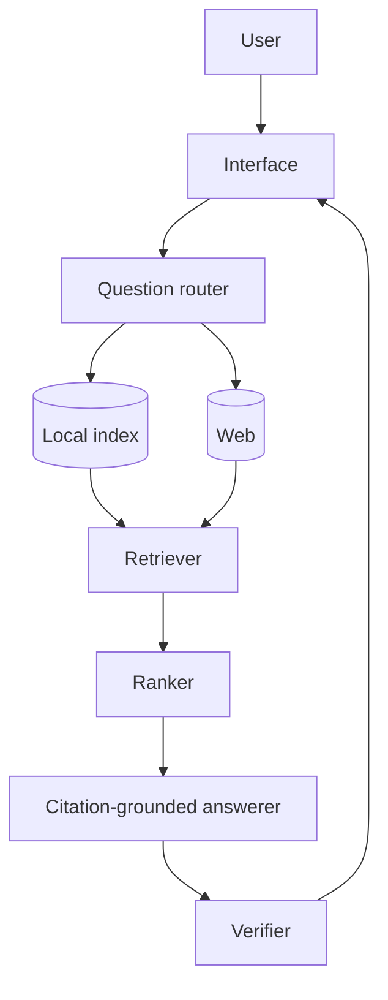

# 19 — Capstone: The Complete Mental Model

> **Part V — Building LocalPerplex — Chapter 19**
> Subproject: `docs/19-capstone/index.md`

---

## 1. First-Principle Question

What is the complete, integrated picture of LocalPerplex, and what ten questions must every answer-engine designer answer before building?

---

## 2. Mental Model

LocalPerplex is one minimal agent loop with two capabilities: grounded retrieval (RAG) and controlled multi-agent research. A question enters, is routed to local and/or web sources, retrieved and ranked into a small evidence packet, turned into a citation-grounded answer by a constrained model, verified for claim-to-source support, and delivered with inline citations and a source list. The whole architecture spans ingestion, retrieval, ranking, answer generation, verification, workspace, interface, privacy, extensions, and evaluation. The ten questions every designer must answer: where does data live, what sources, how is retrieval done, how is ranking done, what counts as evidence, how are citations enforced, what happens with insufficient evidence, local vs cloud model, how does the human stay in control, and how is it evaluated.

---

## 3. How Perplexity-Style Systems Work

Perplexity: question interpretation, web search, source retrieval, cited conversational answer. LocalPerplex: the same loop but local-first, with local and web as equal sources, citations mandatory, and the human in control. What to copy: retrieval, ranking, citation-grounded synthesis. What to change: default to local, make web opt-in, make citations mandatory, add verification, add workspace and extensions.

Sources: [Perplexity Help Center](https://www.perplexity.ai/help-center/en/articles/10352895-how-does-perplexity-work), [Perplexity Photon blog](https://www.perplexity.ai/en-GB/hub/blog/photon), [Agentic RAG dl.acm](https://dl.acm.org/doi/10.1016/j.cosrev.2026.100925)

---

## 4. Local-First Adaptation

The complete mental model applied locally: ingestion on-device, hybrid index local, routing local-first, web opt-in, local model default, citations mandatory, verification before delivery, workspace local, interface shows citations and sources, extensions pluggable, evaluation local.

---

## 5. Architecture Diagram

---

## 6. Design Decisions

| Area | Decision |
|---|---|
| Data locality | Local by default; web/cloud opt-in |
| Sources | Local and web, equal, explicit provenance |
| Retrieval | Hybrid (keyword + semantic) |
| Ranking | First-stage + rerank |
| Evidence | Small packet (5–10 chunks), diverse, sourced |
| Citations | Mandatory, inline, resolve to source list |
| Insufficient evidence | "Not found in sources" |
| Models | Local default; cloud opt-in with consent |
| Human control | Visible routing, toggle, offline indicator, review |
| Evaluation | Local regression suite + metrics |

---

## 7. Failure Modes

| Failure | Consequence | Safeguard |
|---|---|---|
| Forgetting local-first | Data egress by default | Privacy boundary is the first design decision |
| Citations optional | Unverifiable answers | Citations mandatory in system prompt |
| No verification | Fabricated citations ship | Verifier gates delivery |
| Over-engineering the core | Unmaintainable monolith | V1→V5 incremental build order |
| No evaluation | Silent regressions | Local regression suite from V10 |

---

## 8. Design Rules

1. One minimal agent loop.
2. Retrieval is a tool layer; multi-agent is an orchestration layer on top.
3. Local evidence first; web when needed; citations always.
4. The human stays in control: visible routing, toggle, review.
5. Build V1→V5 incrementally; never skip milestones.

---

## 9. Checkpoint

- [ ] Complete architecture described end-to-end
- [ ] Ten questions every designer must answer enumerated
- [ ] MVP checklist (V1–V3) defined
- [ ] Production-ready checklist (V4–V10) defined
- [ ] What to copy from Perplexity vs what to change documented