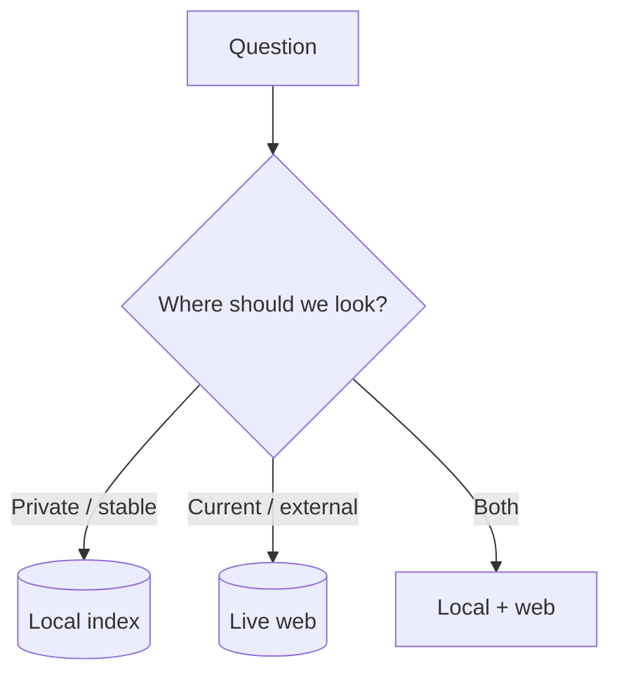
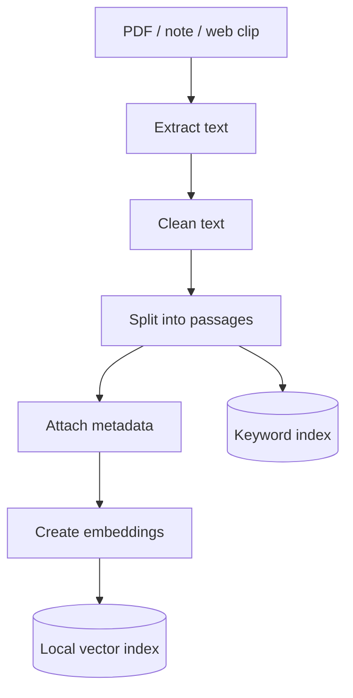
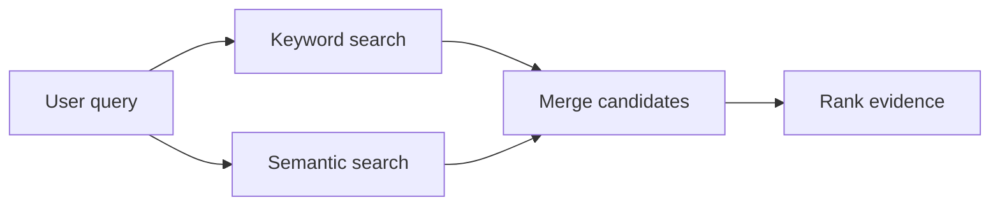
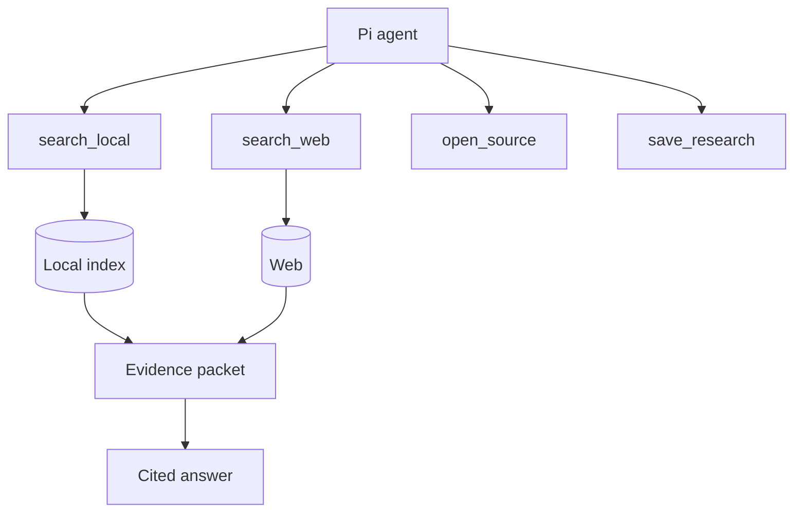

# 20 — Feature 1: Search + RAG

> **Feature 1 — Search and RAG — Sections 1–10**
> Subproject: `docs/20-search-rag/index.md`

---

## 1. First-Principle Question

How does Pi gain the ability to answer questions from the user's own knowledge base and the live web, grounded in retrieved evidence with citations, instead of repeatedly reading files or shelling out to web search?

---

## 2. Mental Model

Search finds information; RAG turns retrieved information into a grounded answer. The three-stage RAG pattern: retrieve relevant content from an index, augment the prompt with the question and retrieved content, generate a response grounded in that content. Modern systems add indexing, reranking, and citation alignment. Search gives sources; RAG gives an answer based on sources; citations let the user verify. LocalPerplex needs two knowledge sources: local (PDFs, notes, Markdown, code, saved pages) for private stable knowledge, and live web (news, docs, research, current events) for fresh external knowledge.

Source: [RAG concept](https://learn.microsoft.com/en-us/azure/foundry/concepts/retrieval-augmented-generation)

---

## 3. How Perplexity-Style Systems Work

Perplexity uses hybrid retrieval, multi-stage ranking, reranking, and citation-oriented generation. Enterprise internal-knowledge search combines internal files and the web, selecting relevant sections and citing them. The model is a constrained synthesizer over selected evidence.

Source: [Perplexity Photon blog](https://www.perplexity.ai/en-GB/hub/blog/photon), [Perplexity Help Center](https://www.perplexity.ai/help-center/en/articles/10352895-how-does-perplexity-work)

---

## 4. Local-First Adaptation

The local index is the heart of private RAG. Ingestion accepts PDFs, Markdown notes, text files, web clippings, code files, and saved articles. Extraction preserves page number, section headings, tables, footnotes, and source URL/path. Cleaning removes repeated headers, navigation text, ads, broken characters, and duplicate boilerplate. Chunking creates small self-contained passages (one idea, with overlap, section title, page number, source ID). Metadata carries source ID, path/URL, page, title, date, tags, author. Embeddings capture meaning; keyword search catches exact terms. Hybrid retrieval merges keyword + semantic results and ranks them. Retrieval produces 100+ candidates, filters duplicates/irrelevant, fast first-stage ranking to top-20, accurate reranking, then selects 5–10 evidence chunks. The evidence packet contains passage text, source title, URL/path, page, date, score, and citation ID. Generation is citation-grounded: use only provided evidence, cite every important claim, say "not found in sources" when insufficient, distinguish facts from interpretation, show conflicts.

In Pi terms, add tools: `search_local` (search local index), `search_web` (search live web, if permitted), `open_source` (read a full source or section), `save_research` (save evidence, notes, answer). The agent loop stays the same: question → model → tool choice → tool → evidence → grounded answer.

---

## 5. Architecture Diagram

---

## 6. Design Decisions

| Decision | Choice | Rationale |
|---|---|---|
| RAG pattern | Retrieve → augment → generate | Standard three-stage; cite as fourth output |
| Sources | Local + live web | Private stable knowledge + fresh external knowledge |
| Indexing | Extract → clean → chunk → metadata → embed → index | Full pipeline preserves citable provenance |
| Chunking | One idea per chunk, overlap, section+page+source ID | Keeps context without splitting answers |
| Retrieval | Hybrid (keyword + semantic) | Exact terms + semantic meaning |
| Ranking | First-stage → rerank → select | Fast broad recall, then precise selection |
| Evidence packet | 3–8 local chunks + 3–8 web passages | Small, diverse, non-repetitive |
| Generation | Citation-grounded, evidence-only | Anti-hallucination |
| Pi tools | `search_local`, `search_web`, `open_source`, `save_research` | Maps RAG to Pi's tool layer |

---

## 7. Failure Modes

| Failure | Consequence | Safeguard |
|---|---|---|
| Bad chunking | Answer split across chunks | Semantic chunking, overlap |
| Poor embeddings | Wrong retrieval | Hybrid search |
| Stale web data | Wrong current answer | Date filtering |
| Low-quality source | Misinformation | Source-quality ranking |
| Missing citation | Unverifiable answer | Citation enforcement |
| Hallucination | False confidence | Evidence-grounded prompts |
| Context overflow | Cost and poor reasoning | Evidence packet limits |

---

## 8. Design Rules

1. Retrieve before generating.
2. Use hybrid retrieval: keyword + semantic.
3. Rerank before final selection.
4. Keep evidence packets small.
5. Cite every important claim.
6. Say when evidence is insufficient.
7. Separate local and web provenance.
8. Never let the model answer from memory alone for factual research.

---

## 9. Checkpoint

- [ ] RAG three-stage pattern defined (retrieve → augment → generate → cite)
- [ ] Two knowledge sources specified (local + live web)
- [ ] Local indexing pipeline defined (extract → clean → chunk → metadata → embed → index)
- [ ] Chunking rules (one idea, overlap, section+page+source ID) specified
- [ ] Hybrid retrieval (keyword + semantic) selected
- [ ] Ranking pipeline (first-stage → rerank → select) defined
- [ ] Evidence packet structure and size limits specified
- [ ] Citation-grounded generation rules documented
- [ ] Pi tool mappings defined (`search_local`, `search_web`, `open_source`, `save_research`)
- [ ] Failure modes and safeguards enumerated
- [ ] Eight design rules established