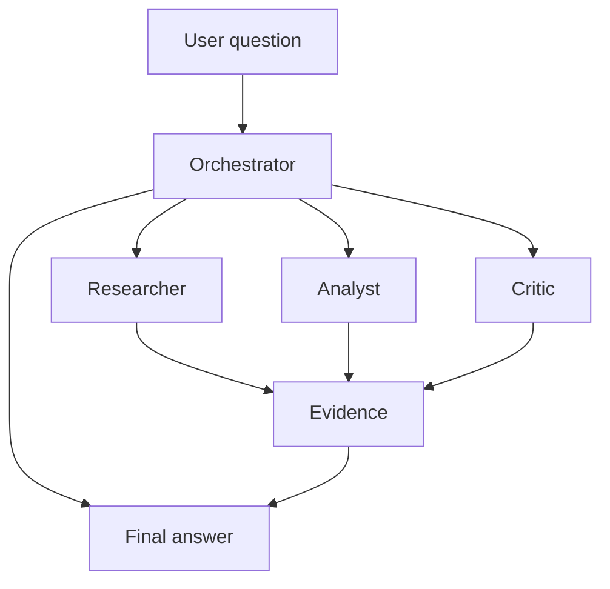
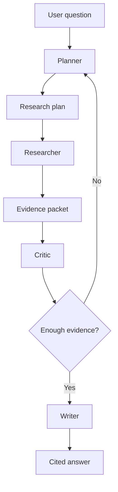
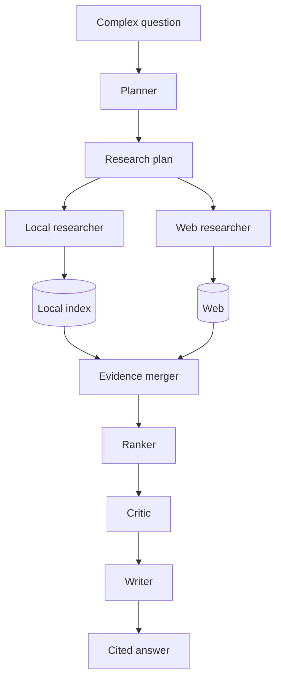

# 21 — Feature 2: Multi-Agent Orchestration

> **Feature 2 — Multi-Agent Orchestration — Sections 11–21**
> Subproject: `docs/21-multi-agent-orchestration/index.md`

---

## 1. First-Principle Question

How does Pi divide complex research into focused roles (planner, researcher, critic, writer) without becoming a large, autonomous, unmanageable agent framework?

---

## 2. Mental Model

Multi-agent means a controlled division of labor, not many separate LLMs talking randomly. The simplest useful version has three roles: planner (breaks question into research steps), researcher (retrieves and collects evidence), synthesizer/writer (writes the cited answer). The minimal architecture is an orchestrator-worker pipeline: user question → planner → research plan → researcher → evidence packet → critic → enough evidence? (no → back to planner; yes → writer) → cited answer. This keeps one agent loop; multi-agent behaviour is an orchestration layer on top, not a replacement for the core. Execution models: sequential (start), parallel (broad research), hierarchical (complex), debate (high stakes), recursive (deep research).

---

## 3. How Perplexity-Style Systems Work

Perplexity-style systems retrieve and synthesize in a single pass. Agentic RAG extends this: the agent decides what to retrieve, when to retrieve again, and when it has enough evidence. Modern RAG research treats agentic RAG as a distinct paradigm where retrieval decisions become part of the agent's reasoning process.

Source: [Agentic RAG](https://dl.acm.org/doi/10.1016/j.cosrev.2026.100925)

---

## 4. Local-First Adaptation

The pipeline runs locally by default. The planner converts a question into a research plan (what is asked, subquestions, sources needed, order, completion criteria). The researcher uses `search_local`, `search_web`, `open_source`, `save_evidence`. The critic checks claim support, source credibility, evidence sufficiency, contradictions, and gaps; it can block unsupported claims and trigger more research. The writer produces the final answer: direct, cited, explains uncertainty, separates fact from interpretation, avoids unsupported claims. Evidence is shared through a common store. Research rounds are limited. Local and web researchers can work in parallel (V5). All roles require citations from their evidence.

---

## 5. Architecture Diagram

---

## 6. Design Decisions

| Decision | Choice | Rationale |
|---|---|---|
| Role count | Three (planner, researcher, writer) + critic | Start simple; expand only if needed |
| Architecture | Orchestrator-worker pipeline | Controlled, not autonomous free-for-all |
| Execution model | Sequential (start), then parallel | Simple pipelines first; broad research later |
| Evidence sharing | Common evidence store | Avoids repeated work |
| Research rounds | Limited maximum | Prevents infinite loops |
| Citations | Required from every researcher | Grounded outputs at every role |
| Critic authority | Can block unsupported claims | Quality gate before writer |
| Pi integration | `read`→`open_source`, `bash`→`search_web`, new `search_local`/`save_evidence` | Extends Pi's existing tool layer |

---

## 7. Failure Modes

| Failure | Consequence | Safeguard |
|---|---|---|
| Agents repeat work | Wasted cost | Shared evidence store |
| Agents contradict | Confusing answer | Evidence conflict resolution |
| Infinite loops | Run never ends | Maximum research rounds |
| Role confusion | Poor output | Explicit role contracts |
| Over-decomposition | Too many agents | Simple planner rules |
| Hallucinated coordination | Fake progress | Structured task state |

---

## 8. Design Rules

1. Start with three roles, not ten.
2. Give each agent one clear responsibility.
3. Share evidence through a common store.
4. Limit research rounds.
5. Require citations from every researcher.
6. Let the critic block unsupported claims.
7. Make the final writer responsible for clarity.
8. Keep the orchestrator simple.

---

## 9. Integration into Pi

| Pi concept | LocalPerplex extension |
|---|---|
| `read` | `open_source` |
| `bash` | `search_web` |
| New tool | `search_local` |
| New tool | `save_evidence` |
| Extension | Research orchestrator |
| Skill | Deep-research workflow |
| Session | Research thread |
| Compaction | Evidence compression |

Pi already has the right foundation: agent loop, tools, sessions, extensions, skills, compaction. LocalPerplex adds the four tools above plus the research orchestrator extension and deep-research skill. Sessions become research threads; compaction becomes evidence compression.

---

## 10. Minimal Product Build Order

V1 Local RAG → V2 Citations → V3 Web fallback → V4 Hybrid → V5 Multi-agent research (planner, researcher, critic, writer). Do not build all at once.

---

## 11. Final Design Principle

> One minimal agent loop. Two powerful capabilities: grounded retrieval and controlled multi-agent research. RAG grounds the answer in evidence. Multi-agent orchestration divides complex research into manageable roles. Together, they turn a Pi-style coding agent into a local research computer—without abandoning the minimal-core philosophy.

Source: [RAG concept](https://learn.microsoft.com/en-us/azure/foundry/concepts/retrieval-augmented-generation)

---

## 12. Checkpoint

- [ ] Multi-agent meaning defined (controlled division of labor, not autonomous free-for-all)
- [ ] Three roles specified (planner, researcher, writer) + critic
- [ ] Orchestrator-worker pipeline defined with stop condition
- [ ] Execution models enumerated (sequential → parallel → hierarchical → debate → recursive)
- [ ] Agent roles and responsibilities detailed (planner/researcher/critic/writer)
- [ ] Multi-Agent + RAG integration (agentic RAG) specified
- [ ] Failure modes and safeguards enumerated
- [ ] Eight design rules established
- [ ] Pi integration map (tools, extension, skill, session, compaction) defined
- [ ] Minimal product build order (V1→V5) confirmed
- [ ] Final design principle stated