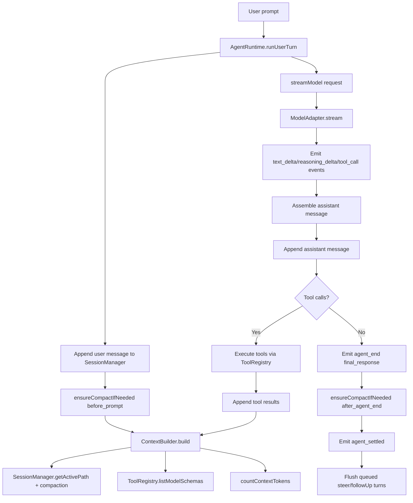
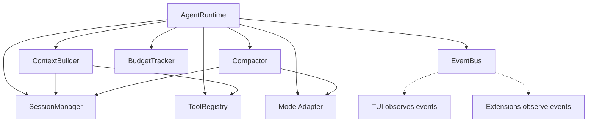

# @kern/agent-core — The Agent Loop

> **Package:** `packages/agent-core`
> **Subproject:** `docs/packages/agent-core/index.md`

---

## 1. First-Principle Question

What is the minimal agent loop — the irreducible sequence of steps that happens every time a user sends a message — and how do context assembly, model streaming, tool execution, compaction, and budgets fit together without a heavy framework?

---

## 2. Mental Model

The agent loop is a **stateful turn runner** (`AgentRuntime`) that owns the model, tools, session store, context builder, event bus, budgets, compactor, and retry policy. Each turn follows:

1. Append the user message to the session.
2. Optionally compact context before the prompt.
3. Build context (system prompt + messages + tools + token count).
4. Stream the model response, emitting events.
5. Append the assistant message.
6. If tool calls exist, execute each, append results, loop back to step 3.
7. If no tool calls, the turn ends; compact after agent end if needed.
8. Emit `agent_settled`; flush any queued (steer/follow-up) turns.

The loop is **single-busy**: only one turn runs at a time; additional prompts are queued with `steer` (after current tools) or `followUp` (after entire run).

Budgets hard-cap turns, tool calls per turn, total tool calls, and wall time. Compaction summarizes history when context approaches the window limit. Retry with exponential backoff handles transient model failures. Secrets in tool output are redacted before persistence.

---

## 3. Architecture Diagram

Component relationships:

---

## 4. Components

### `AgentRuntime` (`agent.ts`)

Owns the turn lifecycle. Key methods:
- `runUserTurn(text, opts)` — the main loop; supports `steer` and `followUp` queuing.
- `streamModel(request, signal)` — streams the model, assembles the message, emits events, retries on failure.
- `executeTool(call, signal)` — executes a tool, redacts secrets in output, emits tool events.
- `compactNow(instructions)` — manual compaction.
- `ensureCompactIfNeeded(phase, signal)` — auto-compaction before prompt / after agent end.
- `setModel(adapter)` — hot-swap model mid-session.
- `setThinkingLevel(level)` — adjusts reasoning budget.

### `ContextBuilder` (`context-builder.ts`)

Builds the per-turn context snapshot: system prompt, messages, tools, token usage. Supports:
- `repoContext` / `repoResolver` for repo-aware context (likely files, symbols, project notes).
- `systemExtra` for AGENTS.md and skills catalog.
- Compaction-aware message slicing (skips entries covered by the last compaction).

### `Compactor` (`compaction.ts`)

Decides when to compact (`evaluate`) using `S + T + H + R + M <= W` (total tokens vs budget), and produces summaries by asking the model itself via `COMPACTION_SYSTEM_PROMPT`. Raw entries stay on disk; only the reconstructed context view changes.

### `BudgetTracker` (`budgets.ts`)

Hard caps: `maxTurns`, `maxToolCallsPerTurn`, `maxTotalToolCalls`, `maxWallTimeMs`. Throws `KernError("E_BUDGET_EXCEEDED", ...)` when exceeded.

### `tokens.ts`

Token estimation: `defaultTokenEstimator` (UTF-8 bytes + lexical tokens), `countMessageTokens`, `countToolsTokens`, `countContextTokens`.

### `retry.ts`

`withRetry(fn, classify, config, callbacks, signal)` — exponential backoff with jitter for retryable model errors.

### `resources.ts` / `ResourceLoader`

Discovers AGENTS.md instruction files (walking up directory tree) and skills (`.agents/skills`, `.pi/skills` with `SKILL.md` frontmatter). Only metadata enters the system prompt; full skill bodies are read on demand via the `read` tool.

### `planning.ts`

`TaskPlan` / `TaskPlanStep` interfaces and `createTaskPlan` / `decomposeTask` helpers for breaking objectives into steps.

### `validation.ts`

`chooseValidationTargets` / `runValidationTargets` — selects vitest/tsc validation targets based on changed files and runs them.

### `event-bus.ts`

Simple pub/sub `EventBus` with typed `AgentEvent` listeners. Errors in listeners are caught and logged, never crashing the emitter.

---

## 5. Failure Modes

| Failure | Consequence | Safeguard |
|---|---|---|
| Model returns no text and no tool calls | Turn ends with empty response | `AssistantMessageAssembler.finalize` returns empty message; turn ends normally |
| Tool call fails | Error appended as tool result; model decides next step | `executeTool` wraps errors in `ToolResultBlock` with `isError: true` |
| Context exceeds window | Compaction triggers | `Compactor.evaluate` checks budget before each turn |
| Compaction fails mid-turn | Turn continues with uncompacted context | Fail-open: logs warning, keeps existing context |
| Model transient failure (network, rate limit) | Turn aborts | `withRetry` retries with exponential backoff |
| Budget exceeded | Turn aborts with diagnostic | `BudgetTracker` throws; runtime appends diagnostic and emits `agent_error` |
| User aborts mid-turn | Turn cancelled | `AbortSignal` propagated through model stream and tool execution |

---

## 6. Design Rules

1. One busy turn at a time; queue additional prompts with `steer`/`followUp`.
2. Build context before every model call (messages change after tool results).
3. Compact before prompt and after agent end, never during.
4. Redact secrets in tool output before persistence.
5. All model failures throw `KernError.model(kind, ...)` for retry classification.
6. Fail-open on compaction failure; fail-closed on budget exhaustion.
7. Events are the only observation surface; TUI and extensions subscribe, never poll.

---

## 7. Checkpoint

- [ ] `AgentRuntime` turn loop defined (user msg → context → model → tools → repeat → end)
- [ ] `ContextBuilder` with repo-aware context and compaction-aware slicing
- [ ] `Compactor` with `evaluate` budget check + model-generated summaries
- [ ] `BudgetTracker` hard caps on turns, tool calls, wall time
- [ ] `withRetry` exponential backoff for model errors
- [ ] `ResourceLoader` for AGENTS.md + skills discovery
- [ ] `EventBus` for decoupled observation
- [ ] Token estimation utilities