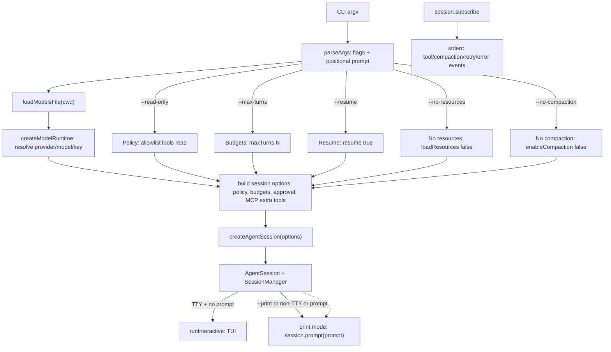

# @kern/cli — Command-Line Entry Point

> **Package:** `packages/cli`
> **Subproject:** `docs/packages/cli/index.md`

---

## 1. First-Principle Question

How does the user start Kern from the terminal — in interactive TUI mode or single-prompt print mode — with model selection, approval handling, and session management all wired together?

---

## 2. Mental Model

`@kern/cli` is the entry point (`main.ts`). It parses CLI flags, loads the models file, resolves the provider/model, optionally discovers MCP tools, creates an agent session via `createAgentSession`, and then either:

- **Interactive mode** (default when TTY and no prompt): launches the TUI (`runInteractive`).
- **Print mode** (`--print` or non-TTY or prompt given): sends a single prompt, streams text deltas to stdout, tool events to stderr, then exits.

Flags cover read-only mode, max turns, cwd, no-resources, no-compaction, resume, list-models, provider/model/base-url/api-key, and help.

Approval is handled via `askApproval` (TTY prompt, non-TTY = deny/fail-closed). The MCP bridge is loaded optionally. Events are subscribed to for logging (tool execution, compaction, retries, errors).

---

## 3. Architecture Diagram

---

## 4. Components

### `main.ts`

| Flag | Purpose |
|---|---|
| `--read-only` | Policy allowlist: only `read` tool |
| `--max-turns N` | Cap agent turns |
| `--cwd DIR` | Workspace root |
| `--no-resources` | Skip AGENTS.md/skill discovery |
| `--no-compaction` | Disable auto-compaction |
| `--resume` | Resume most recent session |
| `--interactive, -i` | Force interactive TUI |
| `--print` | Force single-prompt print mode |
| `--list-models` | List available models and exit |
| `--provider NAME` | Provider from models.json or `KERN_PROVIDER` |
| `--model ID` | Model id (optionally `provider/id`) |
| `--base-url URL` | Override endpoint base URL |
| `--api-key KEY` | Override API key |
| `--help, -h` | Print help |

### Approval

`askApproval(prompt)` — TTY question "[y/N]"; non-TTY returns `false` (fail-closed).

### MCP Bridge

`loadMcpExtraTools(cwd, logger)` — discovers MCP file tools via `@kern/tools`; logs warnings; fail-closed (core continues with zero extra tools on error).

### Event Logging

CLI subscribes to session events and writes to stderr:
- `tool_execution_start/end` — `[tool name]` / `[tool name failed]`
- `auto_compaction_start/end` — `[compacting (phase)…]` / `[compacted]`
- `auto_retry_start` — `[retry attempt (reason) in delayMsms]`
- `agent_error` — `[error code: message]`

---

## 5. Failure Modes

| Failure | Consequence | Safeguard |
|---|---|---|
| No model selected | `E_MODEL_REQUEST` error | Clear message; user must specify `--provider`/`--model` or set env vars |
| Provider unreachable | Model adapter creation may succeed; first turn fails | `testProvider` available via TUI `/connect`; CLI doesn't pre-test |
| Non-TTY interactive mode | Error "Interactive mode requires a TTY" | Falls back to print mode if `--print` or no TTY |
| Approval required, non-TTY | Denied (fail-closed) | `askApproval` returns `false` without a TTY |
| Session creation fails | CLI exits with error code 1 | `main().catch` prints error and exits 1 |

---

## 6. Design Rules

1. CLI is thin: parse args, load config, create session, delegate to TUI or print mode.
2. Non-TTY = deny for approvals (fail-closed).
3. Events logged to stderr; stdout reserved for model text output (machine-readable).
4. Read-only mode is a policy allowlist, not a code path change.
5. MCP bridge is optional; core runs unchanged without it.

---

## 7. Checkpoint

- [ ] Flag parsing for all CLI options
- [ ] Model resolution: provider/model/base-url/api-key with env var fallbacks
- [ ] Interactive TUI mode vs print mode branching
- [ ] Approval handling: TTY prompt, non-TTY deny
- [ ] MCP bridge optional loading with fail-closed
- [ ] Event subscription for stderr logging