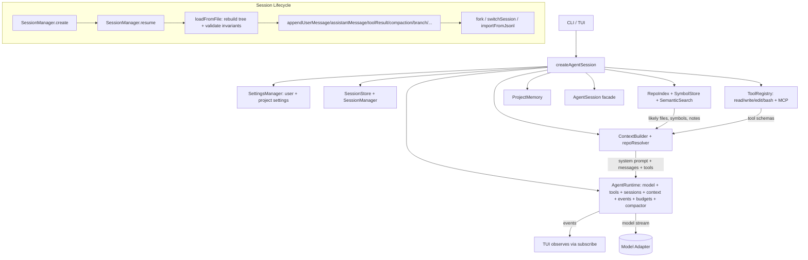

# @kern/coding-agent — Agent Session Facade + Modes

> **Package:** `packages/coding-agent`
> **Subproject:** `docs/packages/coding-agent/index.md`

---

## 1. First-Principle Question

What is the minimal facade that wires together agent-core, session-store, tools, model, repo-index, symbol-store, semantic-search, and project-memory into a usable agent session for interactive TUI and single-prompt print workflows?

---

## 2. Mental Model

`@kern/coding-agent` is the composition root. `createAgentSession(options)` assembles everything: policy, tool registry (read/write/edit/bash + optional MCP), session store + manager, repo index + symbol store + semantic search + project memory, context builder with repo resolver, compactor, and the `AgentRuntime`. It returns an `AgentSession` facade with methods for `prompt()`, `subscribe()`, `setModel()`, `compact()`, `fork()`, `switchSession()`, `importFromJsonl()`, `listSessions()`, etc.

The session is repo-aware: a `repoResolver` uses semantic search + project memory to surface likely files, relevant symbols, and project notes for the current task query, injecting them into the system prompt as repo context.

Settings are loaded from `~/.kern/settings.json` (user, full control) and `.kern/settings.json` (project, fail-closed — may only set thinkingLevel and tighten budgets, never loosen policy).

---

## 3. Architecture Diagram

---

## 4. Components

### `createAgentSession` (`create-agent-session.ts`)

Main entry point. Options:
- `cwd`, `logger`, `storageRoot`
- `policy` (Partial<PolicyConfig>), `budgets` (Partial<BudgetLimits>)
- `requestApproval` — approval callback; absent = deny
- `loadResources` — load AGENTS.md + skills into system prompt (default true)
- `enableCompaction` — automatic compaction (default true)
- `model` — ModelAdapter; defaults to a no-op fake model for tests
- `extraTools` — opt-in extra tools (e.g., MCP bridge); name collisions refused
- `thinkingLevel` — default reasoning mode
- `resume` — resume most recent session vs create new

Returns `{ session: AgentSession, manager: SessionManager }`.

### `AgentSession` Facade

| Method | Purpose |
|---|---|
| `prompt(text, opts)` | Send a user message; runs the agent turn |
| `subscribe(listener)` | Subscribe to `AgentEvent`s (TUI, extensions) |
| `budgetUsage()` / `isBusy()` | Current usage and run state |
| `setModel(adapter)` / `modelInfo()` | Hot-swap and inspect the active model |
| `thinkingMode()` / `setThinkingLevel(level)` | Reasoning mode for supported models |
| `compact(instructions)` / `contextUsage()` | Manual compaction and last context token usage |
| `approvalMode()` / `setApprovalMode()` / `allowToolForSession(name)` | Approval policy and session allowlist |
| `toolNames()` / `callToolAsUser()` | Tool discovery and direct invocation |
| `sessionName()` / `activeLeafId()` / `setSessionName()` | Session identity and naming |
| `fork(entryId?)` / `switchSession(file)` / `importFromJsonl()` / `newSession()` | Session tree/navigation lifecycle |
| `deleteSession()` / `listSessions()` / `branchSummary()` | Session management helpers |
| `steeredPrompt()` / `followUp()` | Queued prompts (steer after current tools; followUp after run) |
| `dispose()` / `isDisposed()` | Runtime teardown |

### Settings (`settings.ts`)

`SettingsManager.load(cwd)` merges:
1. `~/.kern/settings.json` — user settings (full control: policy, budgets, thinkingLevel).
2. `.kern/settings.json` — project settings (fail-closed: may only set `thinkingLevel` and tighten budgets, never loosen policy).
3. Runtime overrides.

`saveProject(cwd, settings)` writes project settings to `.kern/settings.json` (0700 dir, 0600 file).

### Fake Model

For tests and headless mode, `createFakeModel()` returns a `ModelAdapter` that immediately yields `{ type: "finished", reason: "stop" }` with no content.

---

## 5. Failure Modes

| Failure | Consequence | Safeguard |
|---|---|---|
| Session file missing/corrupted | `SessionManager.resume` fails | Falls back to `SessionManager.create` (new session) |
| Model not provided | No-op fake model used | Tests and headless mode work without a real model |
| Extra tool name collision | Collision refused; warning logged | Core tools take precedence |
| Project settings try to loosen policy | Ignored (fail-closed) | Project file may only tighten budgets / set thinkingLevel |
| Repo index not loaded | `ensureLoaded()` triggers refresh | Lazy initialization on first query |
| Compaction disabled | No auto-compaction | `enableCompaction: false` passes `null` compactor |

---

## 6. Design Rules

1. `createAgentSession` is the composition root; all packages are wired here.
2. Settings merge: user (full) → project (fail-closed, tighten only) → overrides.
3. Repo-aware context: semantic search + project memory surface files/symbols/notes for the system prompt.
4. MCP tools are opt-in via `extraTools`; name collisions with core tools are refused.
5. Fake model default enables testing without a real provider.
6. Session tree operations (fork, switch, import) create new `SessionManager` instances, never mutate in place.

---

## 7. Checkpoint

- [ ] `createAgentSession` wires all packages into an `AgentSession` facade
- [ ] Tool registry: read/write/edit/bash + optional MCP extra tools
- [ ] Repo resolver: semantic search + project memory → repo context
- [ ] Settings: user (full) + project (fail-closed) merge
- [ ] Session tree: fork, switch, import, list, delete
- [ ] Fake model for tests/headless