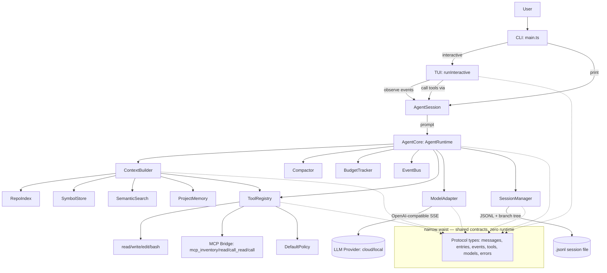
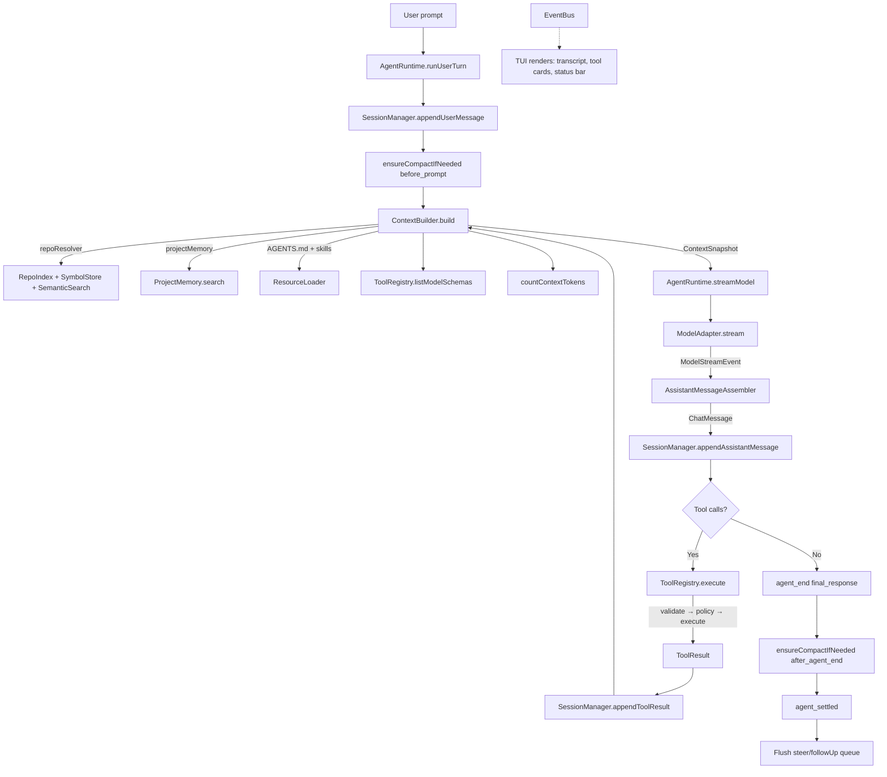

# Kern Packages — Overview & Architecture

> **Subproject:** `docs/packages/index.md`

---

## 1. First-Principle Question

How do 12 small, focused packages compose into a minimal, from-first-principles terminal coding agent — without a heavy framework — while keeping boundaries clean, dependencies explicit, and each package independently testable?

---

## 2. Mental Model

Kern (Pi-style) is a monorepo of 12 workspace packages under `packages/`. Each package has a single responsibility and depends only on what it needs (mostly `@kern/protocol`). Composition happens in `@kern/coding-agent` (`createAgentSession`), which wires agent-core, session-store, tools, model, repo-index, symbol-store, semantic-search, and project-memory into an `AgentSession` facade.

The **protocol package** is the narrow waist: zero runtime behavior, only shared types/contracts. Every cross-package shape lives there. The **agent-core** is the agent loop (turn runner, context builder, compactor, budgets, retry, event bus, resource loader). The **tools** package is the capability layer (registry, policy, built-in read/write/edit/bash, optional MCP bridge). Everything else is a supporting concern: model (provider adapters + discovery), session-store (JSONL + branch tree), repo-index/symbol-store/semantic-search (repo-aware retrieval), project-memory (explicit notes), cli (entry point), and tui (interactive UI).

---

## 3. Package Catalog

| Package | Responsibility | Key Deps |
|---|---|---|
| `@kern/protocol` | Shared contracts: messages, session entries, events, tools, models, errors, Zod schemas | zod |
| `@kern/agent-core` | Agent loop: turn runner, context builder, compactor, budgets, retry, event bus, resource loader, planning, validation | `@kern/protocol`, `@kern/model`, `@kern/session-store`, `@kern/tools` |
| `@kern/session-store` | Append-only JSONL session persistence with branch tree | `@kern/protocol` |
| `@kern/tools` | Tool contract, registry, policy engine, built-in read/write/edit/bash, optional MCP bridge | `@kern/protocol`, zod |
| `@kern/model` | Provider-neutral model adapter (OpenAI-compatible), model discovery, credential resolution | `@kern/protocol` |
| `@kern/coding-agent` | Composition root: `createAgentSession`, `AgentSession` facade, settings | All of the above |
| `@kern/repo-index` | Workspace indexing: file records, imports/exports, FileGraph | `@kern/protocol` |
| `@kern/symbol-store` | Lightweight TS/JS symbol extraction and lookup | `@kern/repo-index`, `@kern/protocol` |
| `@kern/semantic-search` | Repo-aware retrieval + ranking; ReadStrategy/ReadPlan | `@kern/repo-index`, `@kern/symbol-store`, `@kern/protocol` |
| `@kern/project-memory` | Explicit project notes (decision/architecture/bug/pattern/task) persisted to JSON | `@kern/protocol` |
| `@kern/cli` | CLI entry point: flag parsing, model resolution, session creation, TUI or print mode | `@kern/coding-agent`, `@kern/model`, `@kern/tools`, `@kern/tui` |
| `@kern/tui` | Interactive terminal UI: transcript, tool cards, approval dialog, model picker, connect wizard, slash commands | `@earendil-works/pi-tui`, `@kern/coding-agent`, `@kern/model`, `@kern/protocol`, `@kern/session-store` |

---

## 4. Architecture Diagram

---

## 5. Data Flow — End-to-End Turn

---

## 6. Dependency Rules

1. **`@kern/protocol` has no runtime deps** (except zod for schemas). It's the foundation everything imports.
2. **No package imports `@kern/coding-agent`** — it's the composition root (leaf in the import graph).
3. **`@kern/agent-core` depends on protocol, model, session-store, tools** — but not on cli, tui, repo-index, etc.
4. **`@kern/tools` depends only on protocol** (+ zod) — the MCP bridge is opt-in and fail-closed.
5. **`@kern/model` depends only on protocol** — no coupling to agent-core or tools.
6. **`@kern/session-store` depends only on protocol** — pure persistence.
7. **`@kern/cli` and `@kern/tui` are the outermost layers** — they depend on everything but are depended on by nothing.

---

## 7. Failure Boundaries

| Boundary | Failure Behavior | Safeguard |
|---|---|---|
| Protocol shape drift | Cross-package type errors | Single source of truth; Zod schemas validate at runtime |
| Model provider failure | `KernError.model(kind, ...)` | Retry policy classifies retryable kinds; TUI shows error |
| Tool execution failure | `ToolResult` with `isError: true` | Model decides next step; turn continues |
| Session file corruption | `readAll` skips malformed lines; `validateInvariants` on load | Falls back to new session if load fails |
| Compaction failure | Fail-open: keep existing context | Warning logged; turn continues |
| Budget exceeded | `E_BUDGET_EXCEEDED` | Turn aborts with diagnostic; no partial state |
| MCP server unreachable | Zero tools from that server; core continues | Fail-closed per server; warnings logged |

---

## 8. Design Rules

1. One responsibility per package; 12 packages, each under ~500 lines of core logic.
2. Composition happens in `@kern/coding-agent` (`createAgentSession`); no package imports it.
3. The protocol is the narrow waist — all cross-package shapes live there, nowhere else.
4. The agent core is dependency-minimal: protocol + model + session-store + tools only.
5. CLI and TUI are thin outer layers; they delegate to `AgentSession` and never touch internals.
6. Everything is observable via `EventBus`; TUI and extensions subscribe, never poll.
7. Fail-closed by default: approvals denied without TTY, project configs can't loosen policy, project mcp.json stdio refused.

---

## 9. Checkpoint

- [ ] 12 packages cataloged with responsibilities and dependencies
- [ ] Composition root identified: `@kern/coding-agent` → `createAgentSession`
- [ ] Narrow waist: `@kern/protocol` with zero runtime behavior
- [ ] End-to-end turn data flow diagrammed
- [ ] Dependency rules defined (acyclic, protocol at bottom, cli/tui at top)
- [ ] Failure boundaries and safeguards documented