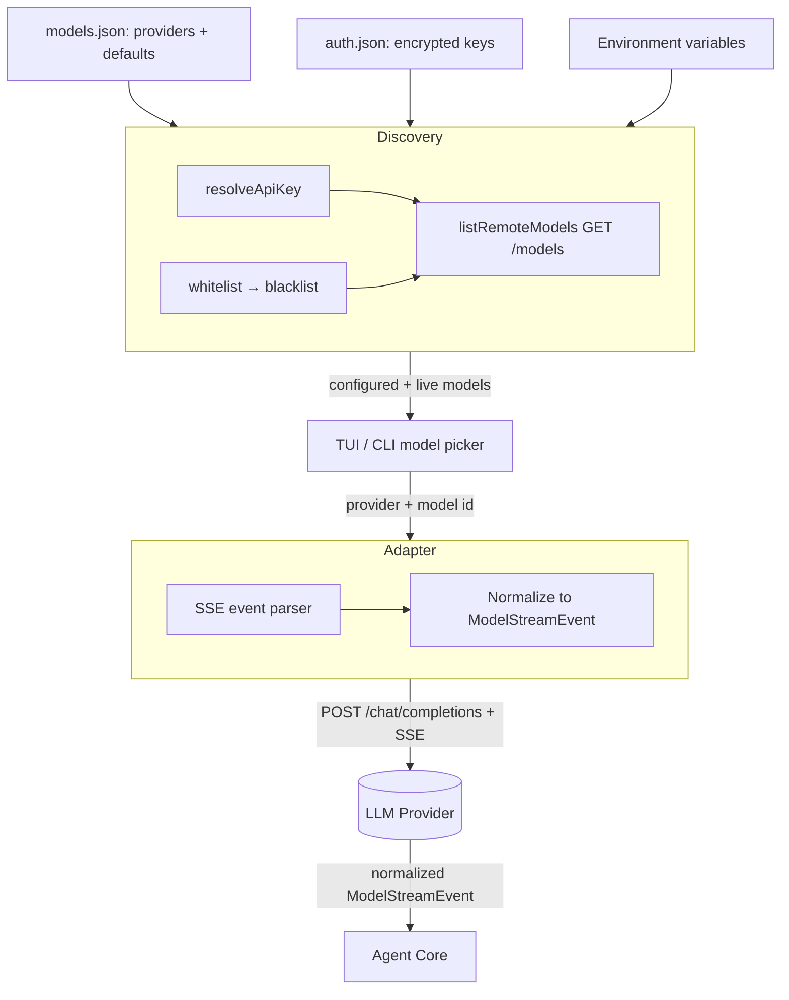

# @kern/model — Provider-Neutral Model Adapter + Discovery

> **Package:** `packages/model`
> **Subproject:** `docs/packages/model/index.md`

---

## 1. First-Principle Question

How can Kern speak to any LLM provider — cloud (OpenAI, OpenRouter, NVIDIA) or local (Ollama, LM Studio, llama.cpp) — through a single normalized interface, without the agent core knowing anything about provider-specific dialects?

---

## 2. Mental Model

`@kern/model` is the model layer: it abstracts away provider differences (roles, tool schemas, streaming chunks, usage fields, stop reasons) so the agent core only ever sees normalized `ModelStreamEvent`s. Every provider that speaks the OpenAI-compatible `POST /chat/completions` + SSE dialect is handled by `createOpenAIAdapter`. Model discovery (`discoverModels`) unions configured models (from `~/.kern/models.json` and project `.kern/models.json`) with live-discovered models (`GET /models`), applying whitelist/blacklist filters and credential resolution.

Credential precedence is explicit: explicit arg > auth.json entry > `!command` / `$VAR` / literal in config > provider env var > loopback-localhost without a key. Literal keys are never written to `models.json`; they go to `~/.kern/auth.json` (0600).

---

## 3. Architecture Diagram

---

## 4. Components

### `discovery.ts` — Configuration + Discovery

| Export | Purpose |
|---|---|
| `ModelsFile` / `ProviderConfig` | Config shapes: providers, defaultProvider, defaultModel, per-provider baseUrl, apiKey, models, whitelist, blacklist |
| `DiscoveredModel` | provider, id, contextWindow, source (`configured`/`live`), authenticated |
| `loadModelsFile(cwd)` | Merges user `~/.kern/models.json` + project `.kern/models.json` (project may not use `!command` for credentials — fail-closed) |
| `discoverModels(file, input, options)` | Unions configured + live models across providers; applies whitelist then blacklist; marks authenticated status |
| `createAdapterFor(file, providerName, modelId, input, logger)` | Builds an OpenAI adapter for a selected model |
| `createModelRuntime(file, input, logger)` | High-level entry: resolve provider/model from input or defaults; creates adapter |
| `testProvider(baseUrl, apiKey, options)` | Tests a base URL + key; returns friendly failures (never throws raw) |
| `saveProviderToUserFile(name, cfg, opts)` | Persists a provider; moves literal keys to auth.json (0600); only `!command`/`$VAR` references stay in models.json |
| `saveAuthKey` / `clearAuthKey` / `loadAuth` | Manage `~/.kern/auth.json` |
| `PROVIDER_PRESETS` | openai, openrouter, ollama, lmstudio, llamacpp, nvidia |

### `openai.ts` — OpenAI-Compatible Adapter

`createOpenAIAdapter(options)` returns a `ModelAdapter` that:
- POSTs to `{baseUrl}/chat/completions` with SSE streaming (`stream: true`, `stream_options: { include_usage: true }`).
- Parses SSE `data:` frames into normalized `ModelStreamEvent`s: `text_delta`, `reasoning_delta`, `tool_call_delta`, `tool_call_complete`, `usage`, `finished`.
- Buffers tool-call argument fragments by index and emits complete `ToolCallBlock`s at the end.
- Maps stop reasons: `stop`/`tool_calls`/`length`/`content_filter` → normalized `StopReason`.
- Classifies all failures into `KernError.model(kind, ...)` kinds: `auth`, `rate_limit`, `timeout`, `network`, `overloaded`, `invalid_request`, `context_length`, `unknown`, `cancelled`.
- Supports `reasoning_effort` for thinking-level models.

### Credential Resolution

Precedence order:
1. Explicit argument passed at call time.
2. `~/.kern/auth.json` entry for the provider.
3. `apiKey` in config: `!command` (executed via `sh -c`, 10s timeout), `$VAR` env interpolation, or literal (stored in auth.json, not models.json).
4. Provider env var (`apiKeyEnv` or well-known: `OPENAI_API_KEY`, `OPENROUTER_API_KEY`, `NVIDIA_API_KEY`).
5. Loopback localhost (`localhost`, `127.0.0.1`, `::1`) → no key needed.

---

## 5. Failure Modes

| Failure | Consequence | Safeguard |
|---|---|---|
| Provider unreachable (ECONNREFUSED, ENOTFOUND) | `E_MODEL_NETWORK` | `testProvider` gives friendly message ("Can't reach... Is the server running?") |
| Bad credentials (401/403) | `E_MODEL_AUTH` | `testProvider` reports "Key rejected (HTTP 401)"; TUI offers re-auth (`/keys`) |
| Rate limited (429) | `E_MODEL_RATE_LIMIT` | Retry policy in agent-core retries with backoff |
| Provider overloaded (503/504) | `E_MODEL_OVERLOADED` | Retry policy retries |
| Context exceeded | `E_CONTEXT_OVERFLOW` | Compaction in agent-core reduces context before retry |
| Invalid request (400/422) | `E_MODEL_REQUEST` | Not retried; surfaced to user |
| Malformed response | `E_MODEL_MALFORMED` | Not retried; surfaced to user |
| Config has `!command` in project file | Credential stripped (fail-closed) | `loadModelsFile` deletes `!command` apiKey from project config |
| No model selected | `E_MODEL_REQUEST` | Clear error message; user must specify `--provider`/`--model` |

---

## 6. Design Rules

1. One dialect (OpenAI-compatible) covers cloud + local providers; provider quirks absorbed in the adapter.
2. The agent core only sees normalized `ModelStreamEvent`s — never provider-specific chunks.
3. All provider failures throw `KernError.model(kind, ...)` so the retry policy can classify them.
4. Literal API keys are never written to `models.json` — they go to `auth.json` (0600).
5. Project `models.json` may not execute `!command` for credentials (fail-closed against cloned repos).
6. Credential precedence is explicit and documented.
7. Discovery unions configured + live models; only authenticated entries are selectable.

---

## 7. Checkpoint

- [ ] `createOpenAIAdapter` normalizes SSE streams into `ModelStreamEvent`s
- [ ] `discoverModels` unions configured + live models with whitelist/blacklist
- [ ] Credential precedence: explicit → auth.json → config (`!command`/`$VAR`/literal) → env → loopback
- [ ] `saveProviderToUserFile` moves literal keys to `auth.json` (0600)
- [ ] `testProvider` gives friendly failures, never throws raw
- [ ] All failures classified into retryable `ModelErrorKind`s