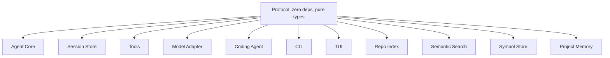

# @kern/protocol — Shared Contracts

> **Package:** `packages/protocol`
> **Subproject:** `docs/packages/protocol/index.md`

---

## 1. First-Principle Question

What is the minimal set of shared shapes that every package must agree on, and why should this package have zero dependencies and zero runtime behavior?

---

## 2. Mental Model

`@kern/protocol` is the single source of truth for all cross-package shapes: messages, session entries, events, tool contracts, model contracts, errors, and validation schemas. It has **no dependencies** (except zod for schemas) and **no runtime behavior** — only types, interfaces, enums, and pure functions. The rule is absolute: if two packages need to agree on a shape, that shape lives here.

This is Pi's "contract layer" pattern: the protocol is the narrow waist through which all packages communicate. Adapters, tools, stores, and the agent core never special-case each other's internals; they speak only the protocol shapes.

---

## 3. Architecture Diagram

---

## 4. Design Decisions

| Decision | Choice | Rationale |
|---|---|---|
| Dependencies | Zero runtime deps (zod only for schemas) | Guarantees the protocol can be imported anywhere without pulling in heavy trees |
| Runtime behavior | None — types + pure functions only | The protocol is a contract, not a service |
| Error type | `KernError` with classified kinds + retryable flag | One error type crosses all boundaries; adapters normalize provider failures into it |
| Session format | JSONL with tree-structured entries (parentId) | Forkable sessions, append-only, crash-safe |
| Event model | Typed `AgentEvent` union emitted via `EventBus` | TUI, extensions, and logging observe without coupling to the agent core |
| Validation | Zod schemas for entries + stream events | Runtime validation where useful, type safety everywhere |

---

## 5. Key Shapes

### Messages (`core.ts`)

| Shape | Fields | Purpose |
|---|---|---|
| `ChatMessage` | role, content[], timestamp | One turn in the conversation |
| `TextBlock` | type, text | Plain text content |
| `ReasoningBlock` | type, text, signature? | Provider chain-of-thought |
| `ToolCallBlock` | type, id, name, arguments? | Model requests a tool call |
| `ToolResultBlock` | type, toolCallId, content, isError, details? | Tool execution result |

### Session Entries (`core.ts`)

The durable event log is a tree, not a list. Every entry has an `id`, `parentId`, `timestamp`, and optional `seq`.

| Entry Type | Purpose |
|---|---|
| `session_header` | Session root; cwd, version, meta |
| `message` | User/assistant/tool message |
| `compaction` | Checkpoint summary replacing prior history |
| `model_change` | Provider/model switch record |
| `label` | User-applied label on an entry |
| `branch` | Fork point in the session tree |
| `branch_summary` | Summary of an abandoned path |
| `session_name` | Human-readable session name |
| `extension` | Extension lifecycle event |
| `diagnostic` | Structured error/warning/info |

### Events (`core.ts`)

Typed `AgentEvent` union observed by the TUI and extensions:

- `session_start`, `turn_start`, `message_start/end`
- `text_delta`, `reasoning_delta` (streaming)
- `tool_execution_start/update/end`
- `auto_compaction_start/end`, `auto_retry_start/end`
- `agent_start/end/error`, `agent_settled`
- `session_diagnostic`

### Model Contracts (`model.ts`)

| Shape | Purpose |
|---|---|
| `ModelAdapter` | `info` + `stream(request)` → `AsyncIterable<ModelStreamEvent>` |
| `ModelRequest` | systemPrompt, messages, tools, maxOutputTokens, thinkingLevel, signal |
| `ModelStreamEvent` | text_delta, reasoning_delta, tool_call_delta, tool_call_complete, usage, finished |
| `ModelInfo` | provider, modelId, contextWindow, maxOutputTokens, supportsThinking, supportsParallelToolCalls |
| `ModelToolSchema` | name, description, inputSchema (JSON Schema subset) |

### Tool Contracts (`tools.ts`)

| Shape | Purpose |
|---|---|
| `ToolDefinition` | name, description, inputSchema, sideEffect, execute(), instructions?, toModelSchema? |
| `ToolContext` | cwd, workspaceRoot, signal, requestApproval?, emitProgress |
| `ToolResult` | content[], isError, details? |
| `SideEffect` | `"read" \| "write" \| "execute" \| "network"` |
| `PolicyDecision` | `allow \| deny \| require_approval` |
| `DefaultOutputBudget` | maxBytes 30000, maxLines 400 |

### Errors (`core.ts`)

`KernError` is the one error type that crosses package boundaries. It carries a `DiagnosticCode`, `retryable` flag, optional `ModelErrorKind`, and `details`.

Model error kinds: `auth`, `rate_limit`, `timeout`, `network`, `overloaded`, `invalid_request`, `malformed_response`, `cancelled`, `unknown`.

Retryable kinds: `rate_limit`, `timeout`, `network`, `overloaded`, `invalid_request`, `malformed_response`.

---

## 6. Failure Modes

| Failure | Consequence | Safeguard |
|---|---|---|
| Two packages drift on a shared shape | Runtime type errors / silent data loss | Single source of truth; all imports from `@kern/protocol` |
| Adapters emit unclassified errors | Retry policy misclassifies failures | All failures must throw `KernError.model(kind, ...)` |
| Session entries mutate in place | Tree integrity broken | Entries are append-only; `parentId` is immutable |
| Invalid JSONL on disk | Session fails to load | `safeValidateSessionEntry` + malformed-line skipping + quarantine option |

---

## 7. Design Rules

1. Zero dependencies (except zod for schemas); zero runtime behavior.
2. If two packages agree on a shape, it lives here — nowhere else.
3. All errors that escape a package boundary are `KernError`.
4. Session entries are append-only; the tree is built from `parentId` links.
5. Model adapters normalize all provider quirks into `ModelStreamEvent`s before the agent core sees them.
6. Validation schemas exist for entries and stream events, but runtime validation is optional per store.

---

## 8. Checkpoint

- [ ] Protocol package is dependency-free (except zod)
- [ ] All cross-package shapes defined (messages, entries, events, tools, models, errors)
- [ ] Zod schemas for runtime validation
- [ ] `KernError` with classified retryable kinds
- [ ] `AssistantMessageAssembler` for normalizing stream events