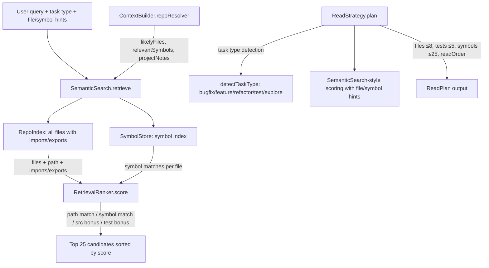

# @kern/semantic-search — Repo-Aware Retrieval & Ranking

> **Package:** `packages/semantic-search`
> **Subproject:** `docs/packages/semantic-search/index.md`

---

## 1. First-Principle Question

Given a user query, how does the agent select a small, relevant set of files to read — using file names, symbols, imports/exports, and task-type hints — without embedding vectors or external search services?

---

## 2. Mental Model

`@kern/semantic-search` provides repo-aware retrieval and ranking. It combines three signals:

1. **File name scoring** — query terms matching the file path (substring match scores highest).
2. **Symbol matching** — symbol hints matched via `SymbolStore.findByName`.
3. **File hints** — explicit file name hints from the user or context.

It also detects task type (`bugfix`, `feature`, `refactor`, `test`, `explore`) from the query, which biases scoring (e.g., test files score higher for `test` tasks). Results are capped at 25 candidates, sorted by score descending.

Two consumers:
- `SemanticSearch.retrieve(intent)` — returns `RetrievalCandidate[]` (path, score, reasons, symbolMatches).
- `ReadStrategy.plan(input)` — returns a `ReadPlan` with taskType, rationale, files (≤8), tests (≤5), symbols (≤25), and a readOrder.

---

## 3. Architecture Diagram

---

## 4. Components

### `SemanticSearch` (`searcher.ts`)

`retrieve(intent: SearchIntent)`:
- `SearchIntent`: query, taskType?, fileHints?, symbolHints?
- Ensures RepoIndex + SymbolStore loaded.
- Scores every file via `RetrievalRanker.score(query, path, symbolMatches)`.
- Adds +15 for file hints, +25 for symbol hints.
- Returns top 25 candidates sorted by score.

### `RetrievalRanker` (`retrieval-ranker.ts`)

`score(name, path, symbolMatches)`:
- +40 if query appears in path (substring).
- +30 if any symbol match contains the query.
- +10 if path contains `src` or `packages`.
- +5 if path contains `test` or `spec`.

### `ReadStrategy` (`read-strategy.ts`)

`plan(input: ReadStrategyInput)`:
- `ReadStrategyInput`: query, taskType?, fileHints?, symbolHints?
- Detects task type from query keywords:
  - `bug|error|fail|crash|null|exception|stack trace|broken|regression` → `bugfix`
  - `test|spec|assert|coverage` → `test`
  - `refactor|cleanup|simplify|rename|extract` → `refactor`
  - `add|implement|create|build|feature` → `feature`
  - default → `explore`
- Scores files (query match +40, task-type bonuses, import/export match +20/+15).
- File hints +25, symbol hints +35.
- Returns `ReadPlan`: taskType, rationale, files (≤8), tests (≤5), symbols (≤25), readOrder (files + tests interleaved).

---

## 5. Failure Modes

| Failure | Consequence | Safeguard |
|---|---|---|
| RepoIndex not loaded | `ensureLoaded()` triggers refresh | Lazy init on first retrieve/plan |
| No files match query | Empty results | Caller handles empty file list gracefully |
| SymbolStore empty | No symbol matches | Falls back to file-name + path scoring only |
| Query is very short/generic | Low signal, many low-score results | Capped at 25; caller can refine with hints |

---

## 6. Design Rules

1. No embeddings, no vector DB — pure regex + substring scoring.
2. Results capped at 25 candidates; read plans cap files at 8, tests at 5.
3. Task type detected from query keywords; biases scoring toward relevant file types.
4. File/symbol hints boost scores (+25/+35) for user-directed retrieval.
5. SymbolStore and RepoIndex are dependencies, not reimplemented here.

---

## 7. Checkpoint

- [ ] `SemanticSearch.retrieve()` scores and ranks files by query match
- [ ] `RetrievalRanker` scoring: path match +40, symbol match +30, src bonus +10, test bonus +5
- [ ] `ReadStrategy.plan()` returns ReadPlan with taskType, rationale, files, tests, symbols, readOrder
- [ ] Task type detection from query keywords (bugfix/feature/refactor/test/explore)
- [ ] File/symbol hints boost scores