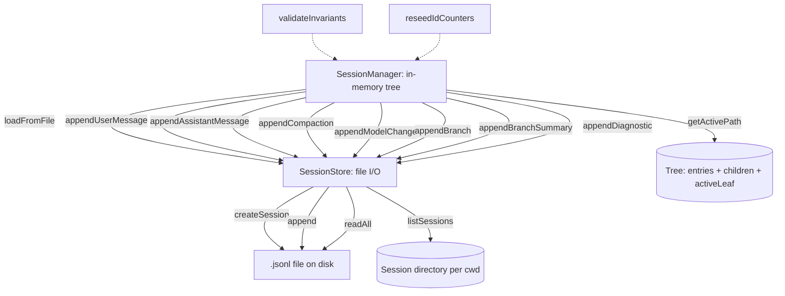
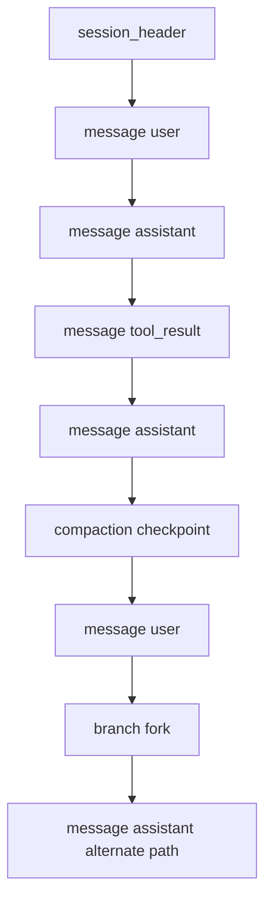

# @kern/session-store — Append-Only JSONL Sessions with Branch Trees

> **Package:** `packages/session-store`
> **Subproject:** `docs/packages/session-store/index.md`

---

## 1. First-Principle Question

How should agent sessions be persisted so they are crash-safe, forkable, tree-structured, and revisitable — without a database?

---

## 2. Mental Model

Sessions are stored as **append-only JSONL files**. Each line is one `SessionEntry` from the protocol. The session is a **tree**, not a list: every entry has a `parentId` (null only for the session header). This enables forking, branching, and revisiting previous turns — exactly like Pi's session tree.

The store (`SessionStore`) handles file I/O: create, append, read-all (streaming), list sessions. The manager (`SessionManager`) loads a file into memory, rebuilds the tree (entries map + children map + active leaf), validates invariants, and provides append methods for every entry type (user message, assistant message, tool result, compaction, model change, branch, branch summary, session name, diagnostic, label).

---

## 3. Architecture Diagram

---

## 4. Components

### `SessionStore` (`jsonl-store.ts`)

File-level operations:
- `createSession(options)` — writes the session header entry, returns file path + header.
- `append(filePath, entry)` — appends one JSONL line.
- `readAll(filePath)` — async generator streaming parsed entries (skips malformed lines).
- `listSessions(cwd, limit)` — lists `.jsonl` files sorted by mtime (newest first).
- `findMostRecent(cwd)` — convenience for `listSessions(limit: 1)`.

File naming: `{createdAt}_{sessionId}.jsonl` where createdAt is `YYYYMMDDTHHMMSSZ`. Session directory encodes the cwd (home-relative paths use `-home-...` prefix).

### `SessionManager` (`session-manager.ts`)

In-memory tree state:
- `entries: Map<string, SessionEntry>` — all entries by id.
- `children: Map<string, string[]>` — parent → child ids.
- `activeLeafId` — the current tip of the active branch.
- `headerId`, `lastSeq` — metadata.

Key methods:
- `static create(store, cwd, meta)` — new session file.
- `static resume(store, cwd, sessionFile?)` — load most recent or specified file.
- `getActivePath()` — walk from activeLeafId up to header via parentId links.
- `getActiveMessages()` — filter active path to message entries only.
- `lastCompaction()` — find the most recent compaction on the active path.
- `appendUserMessage/assistantMessage/toolResult/modelChange/compaction/branch/branchSummary/diagnostic/setSessionName` — append entries, update tree, set active leaf.
- `branchTo(targetId)` — switch active leaf to a previous entry (fork).
- `deleteSession(filePath)`, `listSessions(limit)`.

Append operations are serialized via an `appendChain` promise to prevent concurrent callers from sharing parentId/seq.

### `invariants.ts`

`validateInvariants(state)` checks:
- headerId and activeLeafId exist in entries.
- No cycles in the parentId tree (DFS from header).
- Every non-header entry has a parent that exists.
- Only one root (header) has null parentId.
- activeLeafId points to a real entry.
- seq values are monotonically non-decreasing.

---

## 5. Failure Modes

| Failure | Consequence | Safeguard |
|---|---|---|
| Malformed JSONL line | Entry skipped on load | `readAll` catches parse errors, logs warning, continues |
| Invalid session entry | Entry skipped on load | `safeValidateSessionEntry` when `validateOnLoad` is true |
| Missing header or leaf | Session fails to load | `loadFromFile` throws descriptive error |
| Cycle in parentId tree | Corrupted session | `validateInvariants` detects cycles via DFS; load throws |
| Concurrent appends | Corrupted parentId/seq | `appendChain` serializes all appends |
| Session file deleted externally | Manager has stale state | Methods check `this.filePath`; `deleteSession` is explicit |

---

## 6. Design Rules

1. Append-only JSONL; never rewrite existing lines.
2. Tree-structured via `parentId`; the active leaf is a pointer, not a list index.
3. One root (header) per session; every other entry has exactly one parent.
4. Appends are serialized to prevent concurrent parentId/seq conflicts.
5. Invariants validated on load; corrupted sessions fail fast with clear errors.
6. Id counters reseeded from on-disk entries so resumed sessions never reuse ids.
7. Raw entries stay on disk for audit; compaction only changes the reconstructed context view.

---

## 8. Checkpoint

- [ ] `SessionStore` file I/O (create, append, readAll streaming, list)
- [ ] `SessionManager` in-memory tree (entries, children, active leaf)
- [ ] Tree navigation: `getActivePath`, `getActiveMessages`, `lastCompaction`
- [ ] Append methods for all entry types
- [ ] Fork/branch support via `branchTo`
- [ ] Invariant validation on load
- [ ] Id counter reseeding from on-disk entries