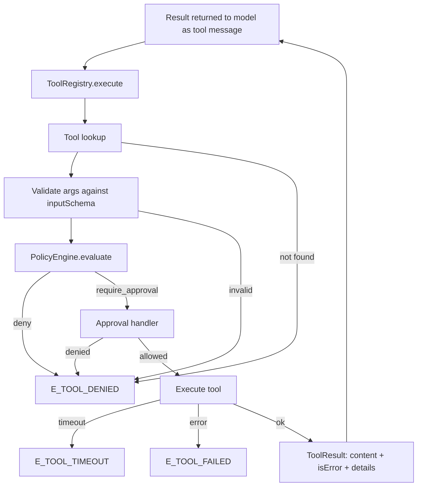
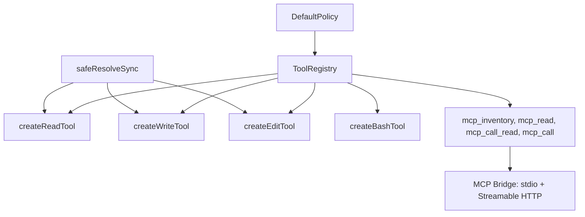

# @kern/tools — Tool Contracts, Registry, Policy, Built-ins

> **Package:** `packages/tools`
> **Subproject:** `docs/packages/tools/index.md`

---

## 1. First-Principle Question

What is the minimal, policy-governed way for an agent to act on the workspace — read, write, edit, execute — without special-casing tool names in the agent core?

---

## 2. Mental Model

The tools package provides the **tool contract** (`ToolDefinition`), a **registry** (`ToolRegistry`) that validates args, applies policy, executes with timeouts, and a set of **built-in tools** (read, write, edit, bash). An optional **MCP bridge** adds four generic tools (`mcp_inventory`, `mcp_read`, `mcp_call_read`, `mcp_call`) for connecting to any MCP server.

The registry is the **only place where capability and policy are decided**. The agent core never special-cases tool names. Every tool call goes through the same pipeline:

1. Look up tool by name → `E_TOOL_UNKNOWN` if missing.
2. Validate arguments against `inputSchema` → `E_TOOL_INVALID_ARGS`.
3. Evaluate policy → `allow`, `deny` (`E_TOOL_DENIED`), or `require_approval`.
4. Execute with registry-level timeout → `E_TOOL_TIMEOUT`.
5. Return `ToolResult` (content, isError, details).

Policy decisions are driven by `SideEffect` (read/write/execute/network), approval mode, destructive command patterns, sensitive paths, and session-level allowlists.

---

## 3. Architecture Diagram

---

## 4. Components

### `ToolRegistry` (`tools.ts`)

Core execution pipeline:
- `register(tool)` / `unregister(name)` / `has(name)` / `toolNames()` / `listModelSchemas()`.
- `callTool(name, args, opts)` — convenience wrapper around `execute`.
- `execute(name, args, signal, opts)` — full pipeline: lookup → validate → policy → execute-with-timeout → result.
- `configurePolicy(mutator)` — mutate `DefaultPolicy` (approval mode, session allowlist).
- `maxToolMs` (default 120s) caps every tool call; timeout aborts via `AbortController`.

### Built-in Tools (`tools.ts`)

| Tool | SideEffect | Purpose |
|---|---|---|
| `read` | `read` | Read file contents (offset/limit, 2MB cap, binary detection) or directory listing |
| `write` | `write` | Create/overwrite files (500KB payload cap) |
| `edit` | `write` | Replace exact text; requires unique match unless `replaceAll`; emits unified diff |
| `bash` | `execute` | Run shell commands (process group kill, output capture capped at 1MB) |

All file tools use `safeResolveSync`/`safeResolve` to prevent workspace escape (`path-safety.ts`).

### `DefaultPolicy` (`policy.ts`)

Policy engine driven by `PolicyConfig`:
- Denylist / allowlist tools.
- Sensitive path blocking (`.ssh`, `.aws`, `.env`, auth files, etc.).
- Destructive command pattern detection (`rm -rf`, `git reset --hard`, `curl | sh`, etc.) → `require_approval`.
- Approval modes: `ask` (prompt per op), `never` (auto-allow), `auto-allowlist` (session-allowed tools skip prompts).
- Read-only tools always allowed; write/execute/network tools ask unless auto-allowlisted.

### `MCP Bridge` (`mcp-bridge.ts`)

Opt-in plugin, not core. Discovers MCP servers from:
1. `KERN_MCP_COMMAND` / `KERN_MCP_URL` env vars.
2. `~/.kern/mcp.json` (user, trusted for stdio).
3. Project `mcp.json`, `.mcp.json`, `.vscode/mcp.json` (project, untrusted — http(s) only; stdio refused).

Registers four generic tools:
- `mcp_inventory` — list servers and tools/resources/prompts.
- `mcp_read` — read MCP resources/prompts (http only, read-only).
- `mcp_call_read` — call read-only MCP tools (`readOnlyHint: true`).
- `mcp_call` — call any MCP tool (asks approval like bash).

Supports stdio (spawn + JSON-RPC) and Streamable HTTP (POST-per-request + SSE parsing). Fail-closed: any protocol error yields zero tools; core runs unchanged.

### Supporting Modules

| Module | Purpose |
|---|---|
| `path-safety.ts` | `safeResolve` / `safeResolveSync` — resolve paths inside workspace root, throw on escape |
| `policy-config.ts` | `PolicyConfig` + Zod schema + defaults |
| `validate-args.ts` | Minimal JSON Schema validator for tool arguments (object/array/scalar types) |
| `protocol.ts` (re-export) | `ToolDefinition`, `ToolContext`, `ToolResult`, `SideEffect`, `PolicyDecision`, `boundText`, `defaultModelSchema`, `textResult`, `toolResultToBlock` |

---

## 5. Failure Modes

| Failure | Consequence | Safeguard |
|---|---|---|
| Unknown tool name | `E_TOOL_UNKNOWN` returned as tool result | Registry lookup before validation |
| Invalid arguments | `E_TOOL_INVALID_ARGS` with field-level errors | `validateArgs` before policy or execution |
| Policy denies tool | `E_TOOL_DENIED` returned | `DefaultPolicy.evaluate` runs before execution |
| Approval denied | `E_TOOL_DENIED` returned | Approval handler returns false; headless = deny |
| Tool times out | `E_TOOL_TIMEOUT` with partial output | Registry-level `maxToolMs` + `AbortController` + process group kill |
| Tool throws internally | `E_TOOL_FAILED` with error message | `execute` wraps tool execution in try/catch |
| Path escapes workspace | `E_TOOL_DENIED` | `safeResolveSync` throws before any file access |
| MCP server unreachable | Zero tools from that server; core continues | Fail-closed per server; warnings logged |
| Project mcp.json runs stdio | Refused with warning | Project files only allow http(s); stdio must be in `~/.kern/mcp.json` |

---

## 6. Design Rules

1. Registry is the only place where capability and policy are decided; agent core never special-cases tool names.
2. Every tool call follows: validate → policy → execute-with-timeout → result.
3. Read-only tools always allowed; write/execute/network tools require approval in `ask` mode.
4. Destructive bash patterns always require approval, even in `auto-allowlist`.
5. All file access goes through `safeResolve*` to prevent workspace escape.
6. MCP is opt-in, fail-closed, and project-stdio is untrusted.
7. Tool output is bounded (`boundText`) before entering model context.

---

## 8. Checkpoint

- [ ] `ToolRegistry` execution pipeline defined
- [ ] Built-in tools: read, write, edit, bash with safety caps
- [ ] `DefaultPolicy` with approval modes, denylist/allowlist, destructive patterns
- [ ] `path-safety` workspace escape prevention
- [ ] MCP bridge: four generic tools, stdio + HTTP, fail-closed
- [ ] `validate-args` minimal JSON Schema validator